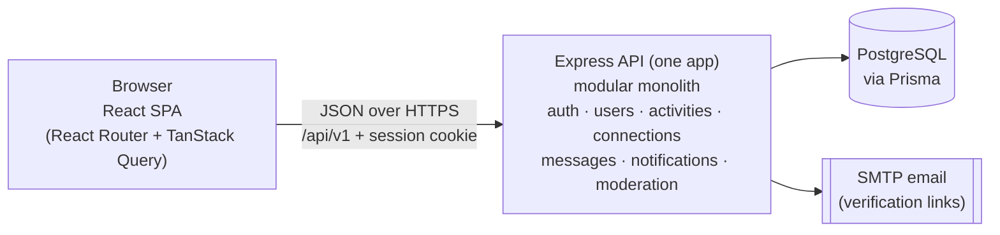

# Spartan Hangout

> Small campus. Big connections.

Spartan Hangout is a web application for San José State University students to find and organize **small group activities**, such as study sessions, pickup games, coffee meetups and gaming nights, and to connect with other Spartans who share their interests.

CMPE 131 – Software Engineering, Group 5:
Chi Huynh (Vincent), Harley Huynh, Harmilap Kasel, Thi Phuc Thinh Huynh.

---

## Current project status

| Item | Status |
|---|---|
| Proposal, high-level requirements, functional requirements (FR01–FR57), US08 design diagrams, UI mockups | Done (course deliverables) |
| Architecture & planning documentation (this repository's `docs/`) | **Drafted, awaiting team review** |
| Application code | **Not started.** Nothing below under "Main features" exists yet |
| Next step | [Milestone 0 – Foundation](docs/roadmap.md#m0--project-foundation), starting only after the team approves these docs |

Everything in this README that describes the app's behavior, commands or folders is **planned**. Nothing has been implemented yet.

---

## Main features (planned)

| Area | What students will be able to do | Requirements |
|---|---|---|
| Accounts | Register with an `@sjsu.edu` email, verify it by email, log in and out; repeated failed logins lock the account | US01, US04 · FR01–FR04, FR09–FR11 |
| Profiles | Keep interests and weekly availability; edit the profile; view other students' profiles (email stays private); delete the account | US02, US03, US05 · FR05–FR08, FR12–FR13 |
| Find activities | See a Recommended list that matches their interests and availability; search by type, date, time and location; open activity details | US06, US07 · FR14–FR20 |
| Join and leave | Join an open activity (only one person can win the last spot); leave before it starts | US08, US09 · FR21–FR25 |
| Organize | Create, edit and cancel activities; remove participants; post updates | US10–US13, US15 · FR26–FR34, FR38–FR39 |
| Group chat | Message the other participants of an activity | US14 · FR35–FR37 |
| Notifications | Get in-app notifications about changes, cancellations, updates, joins and leaves | US16 · FR40–FR42 |
| Connections | Discover students with shared interests, connect with them, and send direct messages | US17–US19 · FR43–FR49 |
| Safety | Report students or activities (an administrator reviews reports); block students | US20, US21 · FR50–FR57 |

User-story numbers follow the **Functional Level Requirements** document. See [traceability.md](docs/traceability.md) for how each requirement maps to the design.

## Technology stack

| Layer | Technology |
|---|---|
| Language | TypeScript (strict) across the frontend, backend and shared package |
| Frontend | React, React Router, TanStack Query; built with Vite; styled with CSS Modules |
| Backend | Node.js (LTS), Express, Zod |
| Database | PostgreSQL, accessed through Prisma ORM |
| Shared code | An npm workspace package with Zod schemas, enums, constants and DTO types |
| Testing (planned) | Vitest, Supertest |
| Dev / CI | Docker Compose (PostgreSQL), GitHub Actions |

A few small supporting libraries are required by specific FRs, for example password hashing and sending verification emails. They are listed and justified in [architecture.md § Supporting libraries](docs/architecture.md#supporting-libraries). There is no Redux or Zustand, no WebSockets, no message queue and no microservices.

## High-level architecture



- There is **one Express backend**, divided into feature modules. Inside each module, the layers are **Controller → Service → Repository**, used only where they help.
- **REST + JSON** API under `/api/v1`. Chat and notifications refresh by polling.
- **Server-side sessions** are stored in PostgreSQL and referenced by an httpOnly cookie.
- **Zod schemas are shared** between client and server, so validation rules stay identical.

Details: [docs/architecture.md](docs/architecture.md).

## Repository structure (planned)

```
spartan-hangout/
├── apps/
│   ├── web/                    # React SPA (feature-organized)
│   │   └── src/
│   │       ├── app/            # router, providers, layouts
│   │       ├── components/     # shared UI components
│   │       ├── lib/            # api client, formatting helpers
│   │       └── features/       # auth, discover, activities, plans, chat, inbox, people, profile, moderation, admin
│   └── api/                    # Express API
│       ├── prisma/             # schema.prisma, migrations, seed
│       ├── src/
│       │   ├── modules/        # auth, users, activities, connections, messages, notifications, moderation
│       │   ├── common/         # relationship policy, errors, time, middleware
│       │   └── jobs/           # in-process scheduled job (mark activities Completed)
│       └── test/               # integration tests (Supertest), added in later milestones
├── packages/
│   └── shared/                 # Zod schemas, enums, constants, messages, DTO types
├── docs/                       # architecture, ADRs, API, data model, roadmap, traceability, open questions
├── .github/workflows/          # CI
├── docker-compose.yml          # PostgreSQL for development and tests
└── package.json                # npm workspaces root
```

## Development prerequisites

- Node.js LTS (the exact version will be pinned in `.nvmrc` in Milestone 0) and npm
- Docker with Docker Compose
- Git

## Planned setup

These commands are **not available yet**. Milestone 0 creates them.

```bash
git clone <repo-url> spartan-hangout && cd spartan-hangout
npm install
cp apps/api/.env.example apps/api/.env

docker compose up -d        # PostgreSQL (dev + test databases)
npm run db:migrate          # apply Prisma migrations
npm run db:seed             # demo students and activities

npm run dev                 # API on :3000, web on :5173 (Vite proxies /api to the API)
```

In development, verification emails are not actually sent. The verification link is printed to the API console.

| Planned script | Purpose |
|---|---|
| `npm run dev` | Run the API and web app in watch mode |
| `npm run build` | Type-check and build every workspace |
| `npm run lint` | ESLint |
| `npm test` | Vitest (unit, plus Supertest integration tests) |
| `npm run db:migrate` / `db:seed` / `db:reset` | Database lifecycle |

## Documentation

| Document | Contents |
|---|---|
| [Architecture](docs/architecture.md) | Overall structure, modules, layers, frontend, auth, validation, errors, security, deployment, testing architecture |
| [Data model](docs/data-model.md) | Entities, relationships, constraints, indexes, concurrency, ER diagram |
| [API](docs/api.md) | Planned REST endpoints with auth, request, response and errors |
| [ADRs](docs/adr/README.md) | Architecture Decision Records |
| [Roadmap](docs/roadmap.md) | Milestones M0–M14 with numbered tasks that can be converted into the Product Backlog |
| [Traceability](docs/traceability.md) | FR01–FR57 mapped to module, endpoint, milestone and verification area |
| [Open questions](docs/open-questions.md) | Unclear requirements, UI/FR conflicts, and decisions waiting on the team |

**Sources of truth:** the course deliverables (Proposal, HLR, Functional Level Requirements, Design, UI mockups). When they conflict, the conflict is written down in [open-questions.md](docs/open-questions.md) instead of being decided silently.

## License

[MIT](LICENSE)
