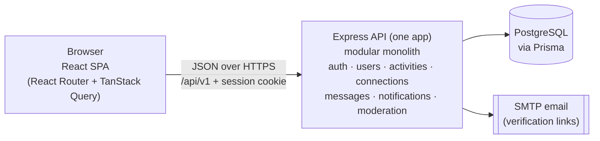

# Spartan Hangout

> Small campus. Big connections.

Spartan Hangout is a web application for San José State University students to find and organize **small group activities**, such as study sessions, pickup games, coffee meetups and gaming nights, and to connect with other Spartans who share their interests.

It is a **responsive, mobile-first full-stack web app**, not a native mobile app. It's designed for phones first, following the UI mockups, with layouts made for tablets and desktop browsers too.

This project is an independent implementation inspired by a team software-engineering project originally designed for SJSU CMPE 131. The original requirements and design were developed collaboratively by Team 5. This repository contains my own implementation and subsequent extensions

CMPE 131 – Software Engineering, Team 5:
Chi Huynh (Vincent), Harley Huynh, Harmilap Kasel, Thi Phuc Thinh Huynh.

---

## Current project status

| Item | Status |
|---|---|
| Proposal, high-level requirements, functional requirements (FR01–FR57), US08 design diagrams, UI mockups | Done (course deliverables) |
| Architecture & planning documentation (this repository's `docs/`) | **Drafted, awaiting team review** |
| [Milestone 0 – Foundation](docs/roadmap.md#m0--project-foundation) | **Committed to `main`** (roadmap tasks stay "In review" until a teammate reviews them). Workspaces, Express skeleton with `GET /api/v1/health`, Prisma setup, React app shell with the four tabs, Docker Compose, CI |
| [Milestone 1 – Registration & email verification](docs/roadmap.md#m1--registration--email-verification) | **Committed to `main`.** Register with an `@sjsu.edu` email (FR01–FR02), verification link with 24-hour expiry and resend (FR03), account activation (FR04) |
| [Milestone 2 – Login, sessions & lockout](docs/roadmap.md#m2--login-sessions--lockout) | **Committed to `main`.** Log in and out (FR09), 30-minute idle sessions (FR10), lockout after 5 failed attempts (FR11) |
| Responsive layout | **Implemented, awaiting review.** Phone layout from the mockups; tablet icon rail and desktop sidebar ([Q25](docs/open-questions.md#q25-target-devices)) |
| [Milestone 3 – Profiles & relationship policy](docs/roadmap.md#m3--profiles--relationship-policy) | **Committed to `main`.** Own profile with private email (FR12), edit profile (FR05–FR06), other students' profiles with shared interests and no email (FR13) |
| [Milestone 4 – Activities: create, view, edit, lifecycle](docs/roadmap.md#m4--activities-create-view-edit-lifecycle) | **Implemented, awaiting review.** Create an activity (FR26–FR28), its detail page (FR18), organizer edits with participant notifications stored (FR29–FR30, FR40a), automatic Completed status (FR20), demo seed data |
| [Milestone 5 – Finding activities](docs/roadmap.md#m5--finding-activities) | **Implemented, awaiting review.** Recommended list on Discover (FR14–FR15) and search by category, date range, start-time range and location (FR16–FR17), using the working assumptions for [Q1](docs/open-questions.md#q1-what-discover-means), [Q9](docs/open-questions.md#q9-search-ui-vs-fr16-criteria) and [Q10](docs/open-questions.md#q10-featured-activities-vs-recommended-activities) |
| [Milestone 6 – Joining, leaving & participants](docs/roadmap.md#m6--joining-leaving--participants) | **Implemented, awaiting review.** Join with the FR21 checks and a race-safe last spot (FR21–FR23), leave (FR24–FR25), organizer removes participants (FR33–FR34), participant list (FR19), join/leave notifications stored for the organizer (FR41), My plans |
| [Milestone 7 – Cancellation & notifications](docs/roadmap.md#m7--cancellation--notifications) | **Implemented, awaiting review.** Organizers cancel with an optional reason (FR31–FR32), header bell with unread badge and a Notifications page (FR42) for every notification so far, using the working assumptions for [Q21](docs/open-questions.md#q21-inbox-vs-notifications-bell) and [Q27](docs/open-questions.md#q27-background-polling-and-the-30-minute-idle-timeout) |
| [Milestone 8 – Activity chat & organizer updates](docs/roadmap.md#m8--activity-chat--organizer-updates) | **Implemented, awaiting review.** Group chat for current participants with 5-second polling (FR35–FR37), organizer updates labeled "Update" that notify participants (FR38–FR39, FR40c), read-only once cancelled or completed, using the working assumptions for [Q18](docs/open-questions.md#q18-whitespace-only-messages-and-fields) and [Q22](docs/open-questions.md#q22-organizer-updates-after-an-activity-starts) |
| Other product features | **Not started.** Student discovery and connections are next |
| Next step | [Milestone 9 – Student discovery & connections](docs/roadmap.md#m9--student-discovery--connections) |

The setup commands and scripts below work today. Of the "Main features", registration, email verification, login/logout, profiles, creating, viewing and editing activities, finding them (Recommended and search), joining, leaving and removing participants, cancelling, notifications, and the activity group chat exist so far; the rest is **planned**.

---

## Main features (planned)

| Area | What students will be able to do |
|---|---|
| Accounts | Register with an `@sjsu.edu` email, verify it by email, log in and out; repeated failed logins lock the account |
| Profiles | Keep interests and weekly availability; edit the profile; view other students' profiles (email stays private); delete the account |
| Find activities | See a Recommended list that matches their interests and availability; search by type, date, time and location; open activity details |
| Join and leave | Join an open activity (only one person can win the last spot); leave before it starts |
| Organize | Create, edit and cancel activities; remove participants; post updates |
| Group chat | Message the other participants of an activity |
| Notifications | Get in-app notifications about changes, cancellations, updates, joins and leaves |
| Connections | Discover students with shared interests, connect with them, and send direct messages |
| Safety | Report students or activities (an administrator reviews reports); block students |

User-story numbers follow the **Functional Level Requirements** document. See [traceability.md](docs/traceability.md) for how each requirement maps to the design.

## Technology stack

| Layer | Technology |
|---|---|
| Language | TypeScript 6.0 (strict) across the frontend, backend and shared package |
| Frontend | React 19, React Router 8, TanStack Query 5; built with Vite 8; styled with CSS Modules |
| Backend | Node.js 24 LTS, Express 5, Zod 4 |
| Database | PostgreSQL 17, accessed through Prisma ORM 7 (with its `pg` driver adapter) |
| Shared code | An npm workspace package (`@sh/shared`) with Zod schemas, enums, constants and DTO types |
| Testing | Vitest 5, Supertest |
| Dev / CI | Docker Compose (PostgreSQL), GitHub Actions |

TypeScript is held at 6.0 because typescript-eslint doesn't support TypeScript 7 yet. Prisma is pinned to the stable 7.10 line.

A few small supporting libraries are required by specific FRs, for example password hashing and sending verification emails. They are listed and justified in [architecture.md § Supporting libraries](docs/architecture.md#supporting-libraries). There is no Redux or Zustand, no WebSockets, no message queue and no microservices.

## High-level architecture



- There is **one Express backend**, divided into feature modules. Inside each module, the layers are **Controller → Service → Repository**, used only where they help.
- **REST + JSON** API under `/api/v1`. Chat and notifications refresh by polling.
- **Server-side sessions** are stored in PostgreSQL and referenced by an httpOnly cookie.
- **Zod schemas are shared** between client and server, so validation rules stay identical.

Details: [docs/architecture.md](docs/architecture.md).

## Repository structure

Folders marked *(later)* are created by the milestone that first needs them.

```
spartan-hangout/
├── apps/
│   ├── web/                    # React SPA (feature-organized)
│   │   └── src/
│   │       ├── app/            # router, providers, AppShell layout
│   │       ├── components/     # Button, TextField, Chip, Card, EmptyState, Logo, icons
│   │       ├── lib/            # apiClient (ApiError), queryKeys
│   │       ├── styles/         # design tokens + global CSS
│   │       └── features/       # discover, plans, inbox, profile (placeholders); more per milestone
│   └── api/                    # Express API
│       ├── prisma/             # schema.prisma, seed.ts; migrations/ (later)
│       ├── prisma.config.ts    # Prisma CLI config (schema, migrations, seed, database URL)
│       ├── src/
│       │   ├── app.ts          # createApp(): Express app without listening (used by tests)
│       │   ├── server.ts       # starts the HTTP server
│       │   ├── config/env.ts   # environment variables validated with Zod
│       │   ├── db.ts           # Prisma client
│       │   ├── routes.ts       # /api/v1 router
│       │   ├── common/         # errors, error handler, validate(); auth & relationships (later)
│       │   ├── modules/        # (later) auth, users, activities, connections, messages, notifications, moderation
│       │   ├── jobs/           # (later) scheduled job that marks activities Completed
│       │   └── generated/      # Prisma client output (git-ignored, created by `npm run codegen`)
│       └── test/               # Supertest integration tests
├── packages/
│   └── shared/                 # constants, enums, error codes, messages; Zod schemas & DTOs per milestone
├── docker/postgres/init.sql    # creates the test database
├── docs/                       # architecture, ADRs, API, data model, roadmap, traceability, open questions
├── .github/                    # CI workflow, PR template
├── docker-compose.yml          # PostgreSQL for development and tests
└── package.json                # npm workspaces root
```

## Development prerequisites

- **Node.js 24** (pinned in `.nvmrc`; with nvm: `nvm install && nvm use`) and npm 11
- **Docker** with Docker Compose. On WSL, turn on *WSL integration* for your distro in Docker Desktop settings
- Git

## Setup

```bash
git clone https://github.com/thiphucthinhhuynh/spartan-hangout.git && cd spartan-hangout
nvm use                     # Node 24
npm install
cp apps/api/.env.example apps/api/.env

docker compose up -d        # PostgreSQL with dev + test databases
npm run db:migrate          # create the tables
npm run db:seed             # optional: demo students and activities (password: goSpartans1);
                            #   also enables "Continue as Demo User" on the login page

npm run dev                 # API on :3000, web on :5173 (Vite proxies /api to the API)
```

Then open <http://localhost:5173>. <http://localhost:5173/api/v1/health> should return `{"status":"ok"}`.

Run `npm run db:migrate` again whenever you pull new migrations. Open <http://localhost:5173>: you'll be sent to the login page, which links to registration. In development, verification emails aren't actually sent: the email, including its link, is printed in the API console (leave `SMTP_HOST` empty in `apps/api/.env`).

| Script | Purpose |
|---|---|
| `npm run dev` | Shared package, API and web app in watch mode |
| `npm run build` | Build the API (`apps/api/dist`) and web app (`apps/web/dist`) |
| `npm run typecheck` | `tsc --noEmit` in every workspace |
| `npm run lint` | ESLint |
| `npm run format` / `format:check` | Prettier write / check |
| `npm test` | Vitest in every workspace; API tests use `DATABASE_URL_TEST` (needs `docker compose up -d`) |
| `npm run codegen` | Build `@sh/shared` and generate the Prisma client. Runs automatically before `dev`, `build`, `typecheck` and `test` |
| `npm run check-node` | Stop with a clear message unless this terminal uses the Node version in `.nvmrc`. Runs automatically before `dev`, `build`, `typecheck` and `test` |
| `npm run db:migrate` / `db:seed` / `db:reset` | Database lifecycle (Prisma). `db:seed` adds demo students (e.g. `sammy.spartan@sjsu.edu`, password `goSpartans1`) and activities; see [data-model.md](docs/data-model.md#seed-data-m4) |

### Troubleshooting

| Symptom | Cause and fix |
|---|---|
| "✖ Spartan Hangout needs Node 24" | The terminal is on an older Node. Run `nvm install && nvm use`, or make 24 your default with `nvm alias default 24`. (On Node 20 the API's `argon2` module crashes without any error message.) `npm install` also refuses to run on the wrong version (`.npmrc` has `engine-strict=true`) |
| Page says "We couldn't reach Spartan Hangout", and the browser console shows `502 (Bad Gateway)` for `/api/v1/...` | The web app is running but the API isn't. Look at the `api` lines in the `npm run dev` output for the error, fix it, and restart `npm run dev` |
| API logs a database connection error | PostgreSQL isn't running. Start it with `docker compose up -d` (on WSL, turn on Docker Desktop's WSL integration), then `npm run db:migrate` |
| "Port 5173 (or 3000) is already in use" | Another dev server is still running. Stop it (Ctrl+C in its terminal) before starting a new one |

## Documentation

| Document | Contents |
|---|---|
| [Architecture](docs/architecture.md) | Overall structure, modules, layers, frontend, auth, validation, errors, security, deployment, testing architecture |
| [Data model](docs/data-model.md) | Entities, relationships, constraints, indexes, concurrency, ER diagram |
| [API](docs/api.md) | Planned REST endpoints with auth, request, response and errors |
| [ADRs](docs/adr/README.md) | Architecture Decision Records |
| [Roadmap](docs/roadmap.md) | Milestones M0–M14 with numbered tasks that can be converted into the Product Backlog |
| [Traceability](docs/traceability.md) | FR01–FR57 mapped to module, endpoint, milestone and verification area |
| [Open questions](docs/open-questions.md) | Unclear requirements, UI/FR conflicts, and decisions waiting on the team |

**Sources of truth:** the course deliverables (Proposal, HLR, Functional Level Requirements, Design, UI mockups). When they conflict, the conflict is written down in [open-questions.md](docs/open-questions.md) instead of being decided silently.

## License

[MIT](LICENSE)
