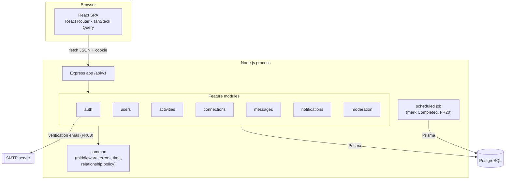
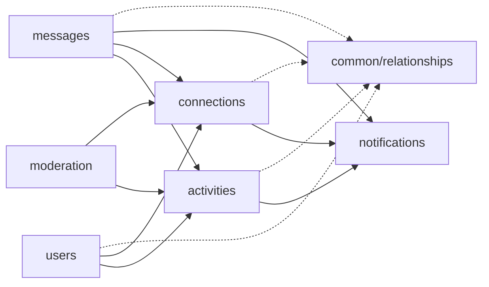
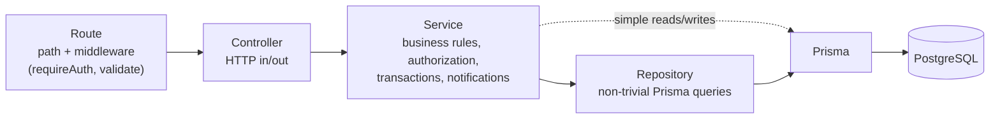
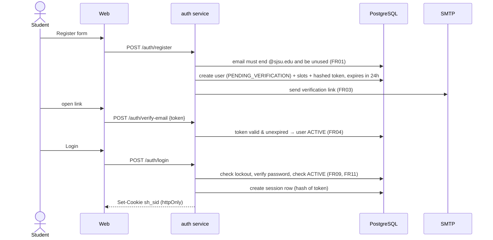
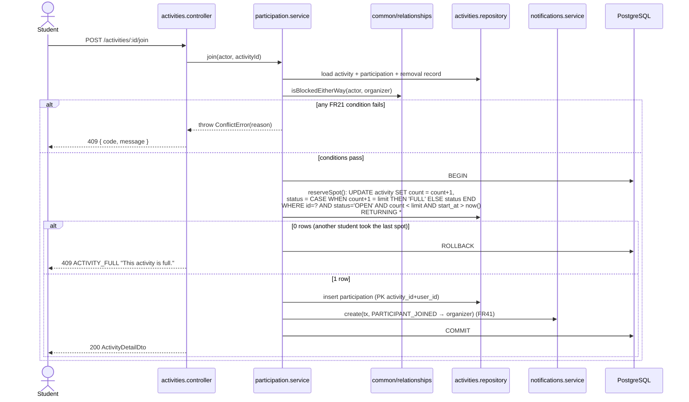
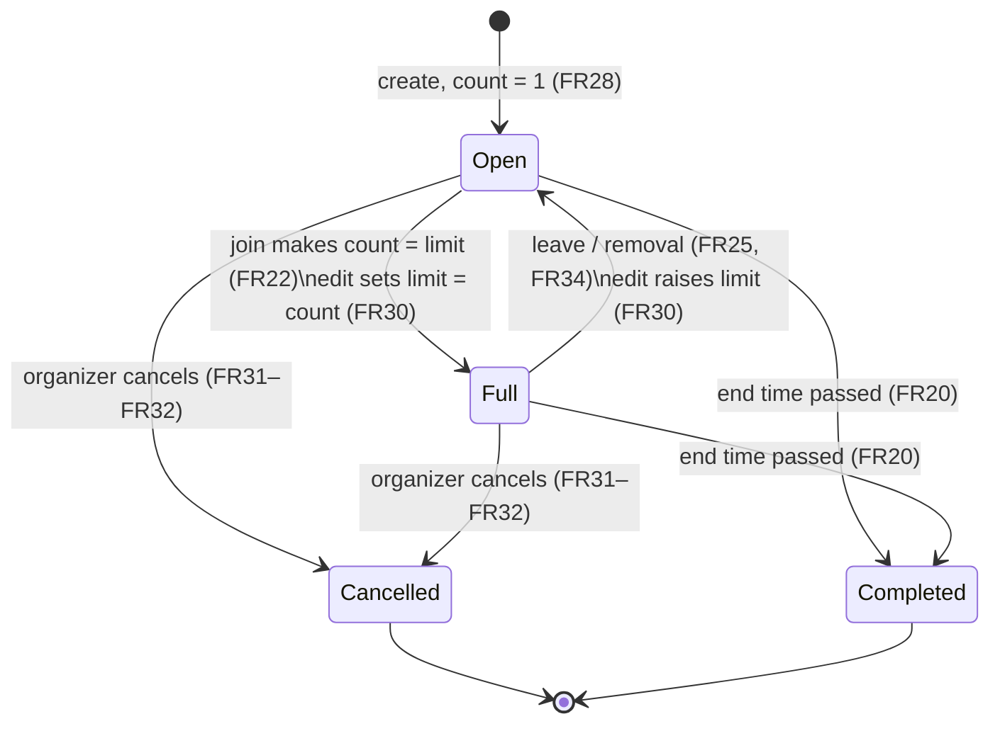

# Architecture

> Status: **planned**. No code exists yet. Reasons for each decision are in the [ADRs](adr/README.md).
> Requirement IDs (FRxx, USxx) refer to the *Functional Level Requirements* document.

- [1. Goals and constraints](#1-goals-and-constraints)
- [2. Overall architecture](#2-overall-architecture)
- [3. Repository and workspaces](#3-repository-and-workspaces)
- [4. Backend: modular monolith](#4-backend-modular-monolith)
- [5. Controller → Service → Repository](#5-controller--service--repository)
- [6. Database access with Prisma](#6-database-access-with-prisma)
- [7. API organization](#7-api-organization)
- [8. Validation](#8-validation)
- [9. Authentication and authorization](#9-authentication-and-authorization)
- [10. Error handling](#10-error-handling)
- [11. Key flows](#11-key-flows)
- [12. Frontend architecture](#12-frontend-architecture)
- [13. Security considerations](#13-security-considerations)
- [14. Deployment considerations](#14-deployment-considerations)
- [15. Testing architecture (future)](#15-testing-architecture-future)
- [Supporting libraries](#supporting-libraries)

---

## 1. Goals and constraints

**Goals**

1. Implement FR01–FR57 as written, with every FR traceable to a module and endpoint ([traceability.md](traceability.md)).
2. Make the risky rules correct by design: capacity under concurrent joins (FR23), blocking (FR55–FR57), email privacy (FR04, FR13), and organizer-only and admin-only actions.
3. Keep the design understandable to all four team members and buildable in one semester.
4. Keep business logic testable without HTTP, and time-dependent rules testable without waiting for real time to pass.

**Constraints**

- Required stack: React, TypeScript, React Router, TanStack Query; Node.js, Express, Zod; PostgreSQL, Prisma; Docker Compose, GitHub Actions.
- One Express backend (a modular monolith). No microservices, message queues, Kubernetes, Redux or Zustand.
- Campus scale: a single API process and a single PostgreSQL database are enough.

**Out of scope.** These are not in the FRs. UI elements that hint at them are listed in [open-questions.md](open-questions.md): image uploads, location/"near you", bookmarks, add-to-calendar, push or email notifications other than verification, unblocking, disconnecting.

---

## 2. Overall architecture



| Actor | Role |
|---|---|
| **Student** | Any verified `@sjsu.edu` account. A student is the **organizer** of the activities they create (and also counts as their first participant, FR28) and a **participant** in activities they join. |
| **Administrator** | Only views reports and marks them Reviewed (FR53). Admins are not part of the normal app flow. How admin accounts get created is an open question ([Q14](open-questions.md#q14-administrator-accounts)). |

---

## 3. Repository and workspaces

A single Git repository with **npm workspaces** ([ADR-0002](adr/0002-monorepo-with-npm-workspaces.md)):

| Workspace | Purpose | May import |
|---|---|---|
| `apps/web` | React SPA | `@sh/shared` |
| `apps/api` | Express API, Prisma schema, scheduled job | `@sh/shared` |
| `packages/shared` | Zod schemas, enums, constants, user-facing messages, DTO types | `zod` only. No Node or browser APIs |

---

## 4. Backend: modular monolith

One Express application, organized into **feature modules** ([ADR-0001](adr/0001-modular-monolith.md)).

### 4.1 Modules

| Module | Responsibility | FRs |
|---|---|---|
| `auth` | Registration, email verification, login and logout, sessions, lockout | FR01–FR04, FR09–FR11 |
| `users` | Own profile (view, edit, delete account); other students' profiles | FR05–FR08, FR12–FR13 |
| `activities` | Create, view, edit, cancel; status lifecycle; search; recommendations; **participation** (join, leave, remove, participant list, My plans) | FR14–FR34 |
| `connections` | Discover students, connection requests, connections | FR43–FR46 |
| `messages` | Activity group chat, organizer updates, direct messages | FR35–FR39, FR47–FR49 |
| `notifications` | Create, list and mark notifications read | FR40–FR42 (and the notifications triggered by FR22, FR25, FR32, FR34, FR45, FR46, FR49) |
| `moderation` | Reports, admin review, blocks | FR50–FR57 |

`activities` is the biggest module. Internally it is split into two services: `activity.service.ts` (lifecycle, search, recommend) and `participation.service.ts` (join, leave, remove).

### 4.2 Shared policy: relationships

Many rules ask the same two questions: "has either student blocked the other?" and "are these two connected?" (FR14f, FR17, FR21e, FR43, FR45, FR48, FR55–FR57). Those reads live in **one** file, `common/relationships.ts`. It reads the `block` and `connection` tables, and no module owns it. This avoids a dependency cycle: moderation (blocking) changes activities and connections, while activities and connections need block checks.

### 4.3 Dependency rules



- One module uses another only by calling that module's **service**. It never imports another module's repository or controller.
- `notifications` and `common/*` depend on no feature module.
- `users → activities/connections` exists only for account deletion (FR08). `moderation → activities/connections` exists only for blocking (FR55–FR56).

### 4.4 Backend folder layout

```
apps/api/
├── prisma/
│   ├── schema.prisma
│   ├── migrations/
│   └── seed.ts
├── src/
│   ├── server.ts                 # starts HTTP server + scheduled job
│   ├── app.ts                    # createApp(): builds the Express app (used by tests)
│   ├── config/env.ts             # environment variables validated with Zod at startup
│   ├── db.ts                     # PrismaClient singleton (Prisma 7 + @prisma/adapter-pg) + DbClient type
│   ├── deps.ts                   # AppDeps: db, mailer, clock, appOrigin (tests override via createApp)
│   ├── routes.ts                 # /api/v1 router; each module mounts its router here
│   ├── health.ts                 # GET /api/v1/health
│   ├── generated/prisma/         # Prisma client output (git-ignored; `npm run codegen`)
│   ├── common/
│   │   ├── errors.ts             # AppError + subclasses, error codes
│   │   ├── errorHandler.ts       # Express error middleware → JSON error envelope
│   │   ├── validate.ts           # validate({ body, query, params }) middleware using Zod
│   │   ├── auth.ts               # AuthUser type on req.user, requireAuth, requireAdmin
│   │   ├── originCheck.ts        # CSRF: reject cross-site Origin on non-GET requests
│   │   ├── relationships.ts      # isBlockedEitherWay(), areConnected(), blockedIdsFor(), orderedPair()
│   │   ├── time.ts               # injectable clock; campus timezone helpers (M4)
│   │   ├── crypto.ts             # random tokens + SHA-256 token hashing
│   │   ├── password.ts           # argon2id hashing
│   │   └── email.ts              # Mailer: SMTP via Nodemailer, or console output when SMTP_HOST is empty
│   ├── modules/
│   │   ├── auth/            auth.routes.ts  auth.controller.ts  auth.service.ts  auth.repository.ts  auth.emails.ts
│   │   │                    session.service.ts  auth.middleware.ts  auth.cookies.ts  auth.lockout.ts
│   │   ├── users/           users.routes.ts users.controller.ts users.service.ts users.mappers.ts
│   │   ├── activities/      activities.routes.ts activities.controller.ts
│   │   │                    activity.service.ts participation.service.ts
│   │   │                    activities.repository.ts activities.mappers.ts
│   │   ├── connections/     connections.routes.ts connections.controller.ts connections.service.ts connections.repository.ts
│   │   ├── messages/        messages.routes.ts messages.controller.ts messages.service.ts
│   │   ├── notifications/   notifications.routes.ts notifications.controller.ts notifications.service.ts
│   │   └── moderation/      moderation.routes.ts moderation.controller.ts reports.service.ts blocks.service.ts
│   └── jobs/
│       └── completeActivities.ts # FR20
├── prisma.config.ts               # Prisma CLI config: schema, migrations, seed, DATABASE_URL
└── test/                          # Supertest integration tests (M0: health smoke test)
```

Not every module has every file. See [§5.3](#53-which-modules-get-which-layers).

---

## 5. Controller → Service → Repository

([ADR-0006](adr/0006-controller-service-repository.md))



### 5.1 Responsibilities

| Layer | Does | Does not |
|---|---|---|
| **Route** | Declares the path, HTTP method, and the `requireAuth` and `validate(schema)` middleware | Contain logic |
| **Controller** | Reads `req.params/body/query` and `req.user`, calls one service function, picks the status code, sends the DTO, and passes errors to `next` (Express 5 forwards rejected promises automatically) | Check domain rules or call Prisma |
| **Service** | Implements use cases: join, enforce capacity, create, cancel, accept a request, block, report. Checks authorization against data, opens transactions, creates notifications, and throws `AppError`s | Touch `req`/`res` or know about status codes |
| **Repository** | Holds Prisma queries that are complex (raw SQL, multi-filter search, the atomic join update) or reused by several services | Contain business decisions |
| **Mapper** | Turns DB rows into response DTOs, and is the one place that decides which fields are public (for example, it never puts email in a public profile) | |

### 5.2 Wiring and testability

Services are plain functions created by a factory that receives their dependencies:

```text
createParticipationService({ db, activitiesRepo, notifications, relationships, clock })
```

Each module's `index.ts` wires the real dependencies. Tests can pass in a fake `clock` (for "has the activity started?" or "is the 24-hour link expired?") or fake collaborators, without a DI framework or module mocking. This is the main thing that keeps the business logic testable.

### 5.3 Which modules get which layers

The layers are used **where they add value**. There are no one-line pass-through repositories.

| Module | Repository? | Why |
|---|---|---|
| `auth` | Yes | Lockout counters, token lookup, and session sliding are fiddly, reused queries |
| `users` | No | Simple Prisma reads and writes. The service calls Prisma directly. A mapper enforces email privacy |
| `activities` | Yes | Search (FR16–FR17), recommendations (FR14), the atomic join (FR23), and status updates, much of it raw SQL |
| `connections` | Yes | The discover query ordered by shared interests (FR44) and pair-ordering logic |
| `messages` | No | Insert and list by activity or conversation. The service calls Prisma directly |
| `notifications` | No | Insert, list, count and mark read. The service calls Prisma directly |
| `moderation` | No | Simple inserts. Cross-module effects go through other services |

Simple read-only endpoints, such as `GET /notifications/unread-count`, may have the controller call a small service query directly. That is fine. **Business rules** must never sit in a controller.

---

## 6. Database access with Prisma

([ADR-0005](adr/0005-postgresql-with-prisma.md))

- `apps/api/prisma/schema.prisma` is the single schema definition. Each milestone adds its tables through a reviewed migration (`prisma migrate dev`).
- One `PrismaClient` instance per process (`src/db.ts`).
- **Transactions:** every use case that writes more than one row runs in `db.$transaction(async (tx) => …)`, and services pass `tx` down to repositories and to `notifications.create(tx, …)`. Notifications therefore commit or roll back together with the change that caused them.
- **Raw SQL** (`$queryRaw` tagged templates, which are parameterized) is used only where Prisma's query API can't express the query:
  - the atomic join `UPDATE … WHERE participant_count < participant_limit … RETURNING` (FR23)
  - recommendations, which need timezone-aware weekday and minute-of-day matching (FR14d)
  - discover students, ordered by the number of shared interests (FR44)
- Database constraints back up the service rules. See [data-model.md](data-model.md).

**Scheduled job (FR20):** `jobs/completeActivities.ts` runs on a `setInterval` (every minute) inside the API process. It runs `UPDATE activity SET status='COMPLETED' WHERE status IN ('OPEN','FULL') AND end_at <= now()`. Running it twice is harmless. The activity mapper also shows `COMPLETED` for any Open or Full activity whose `end_at` has passed, so the UI is correct even between job runs. Search, recommendations and join all require `start_at > now()`, so a slightly late status update never changes a rule's outcome.

---

## 7. API organization

([ADR-0004](adr/0004-rest-api.md); endpoint catalog in [api.md](api.md))

- REST over JSON, versioned under `/api/v1`.
- Routes are grouped by module: `/auth`, `/users`, `/activities`, `/connections`, `/conversations`, `/notifications`, `/reports`, `/blocks`, `/admin`.
- Responses are DTOs defined in `packages/shared/src/dto`, so the frontend and backend share the same types.
- Server-computed **capability flags** in the activity detail (`canJoin`, `canLeave`, `canEdit`, `canCancel`, `canReport`, `joinBlockedReason`) let the UI decide which buttons to show without re-implementing the rules. The server still enforces every action.
- **No WebSockets.** The chat, DM and notification views refresh by polling with TanStack Query (see [§12.4](#124-server-state-vs-local-state)).

---

## 8. Validation

([ADR-0007](adr/0007-zod-validation-shared.md))

| Where | What |
|---|---|
| `packages/shared/src/schemas` | One Zod schema per request: `registerSchema`, `loginSchema`, `profileUpdateSchema`, `activityCreateSchema`, `activityUpdateSchema`, `activitySearchSchema`, `messageSchema`, `reportSchema`, … |
| Client | Forms run `schema.safeParse()` on submit (and on blur) and show each field's issue next to it. This covers "identify each missing or invalid field" (FR02, FR06, FR27) |
| Server: `validate()` middleware | Parses `body`, `query` and `params` with the same schema. A failure returns `422 VALIDATION_FAILED` with per-field messages. The server is always the authority |
| Server: service | Rules that need data or the current time: email already used (FR01), start time in the future (FR27), limit not below the current count (FR30), duplicate pending report (FR51). These use the same error shape |

Limits live in one place, `packages/shared/src/constants.ts`: display name 1–50, password ≥ 8 with a letter and a digit, title 1–100, description 1–500, location 1–100, participant limit 2–100, messages 1–500, reasons ≤ 200, report description ≤ 500, session idle 30 min, lockout 5 attempts in 15 min, verification link 24 h.

Exact user-facing strings quoted in the FRs, such as `"This activity is full."`, `"No matching activities found."`, `"No activities found."`, `"No students found."` and `"Deleted Student"`, live in `packages/shared/src/messages.ts`.

---

## 9. Authentication and authorization

### 9.1 Authentication (FR01–FR04, FR09–FR11)

([ADR-0009](adr/0009-session-based-authentication.md))



- **Session:** a random token is sent in the `sh_sid` cookie (`HttpOnly; SameSite=Lax; Path=/`, `Secure` in production, `Max-Age` 30 minutes renewed together with `last_seen_at`). The `session` table stores only its SHA-256 hash, plus `user_id` and `last_seen_at`.
- **Where the code lives:** the session service and the middleware that sets `req.user` belong to the `auth` module (`session.service.ts`, `auth.middleware.ts`). The generic guards `requireAuth` / `requireAdmin` live in `common/auth.ts`, so other modules never import from `auth`.
- **Idle timeout (FR10):** a session is valid while `now - last_seen_at < 30 min`. Each authenticated request refreshes `last_seen_at`, writing at most once per minute. **Logout** deletes the session row.
- **Lockout (FR11):** the `user` table has `failed_login_count`, `first_failed_login_at` and `locked_until`. Five failures inside 15 minutes lock the account for 15 minutes. A successful login or the end of the lock resets the counter.
- **Generic failure (FR09):** an unknown email and a wrong password return the same `INVALID_CREDENTIALS` message. Unknown emails still run a dummy password check, so timing doesn't give them away. Unverified accounts are reported (`EMAIL_NOT_VERIFIED`) only after a correct password.
- **Locked accounts** are told so with the minutes remaining (`423 ACCOUNT_LOCKED`, [Q16](open-questions.md#q16-lockout-and-enumeration-details)). The lockout rules are a pure function (`auth.lockout.ts`) with their own unit tests.
- **Background polling (M7+)** must not count as activity, or an open tab would never time out. See [Q27](open-questions.md#q27-background-polling-and-the-30-minute-idle-timeout).
- **Passwords:** stored as argon2id hashes (`argon2` package; [Q26](open-questions.md#q26-password-hashing-algorithm)).

### 9.2 Authorization

Authorization is checked where the data is, which means mostly in services:

| Rule | Enforced in |
|---|---|
| Logged in | `requireAuth` middleware on every route except register, verify, resend, login and health |
| Administrator only (FR53) | `requireAdmin` middleware on `/admin/*` |
| Organizer only: edit, cancel, remove participant, post update (FR29, FR31, FR33, FR38) | activities and messages services |
| Current participant only: read or send in group chat (FR35) | messages service (checks for a `participation` row) |
| Connected only: DMs (FR48) | messages service → `relationships.areConnected` |
| Not blocked (FR14f, FR17, FR21e, FR43, FR45, FR55–FR57) | services → `common/relationships` |
| Not yourself: connect, report, block (FR45, FR50, FR54) | connections and moderation services |
| Cancelled/Completed activities visible only to their participants and organizer (FR20, FR32) | activities service |

Profiles hidden by a block (FR57) return `404 NOT_FOUND`, the same as a profile that doesn't exist.

---

## 10. Error handling

- Services throw `AppError(code, httpStatus, message, fields?)` or a subclass (`NotFoundError`, `ForbiddenError`, `ConflictError`, `ValidationError`).
- Express 5 passes thrown and rejected errors to the single `errorHandler` middleware, which returns:

```json
{ "error": { "code": "ACTIVITY_FULL", "message": "This activity is full.", "fields": null } }
```

- Unknown errors are logged (with `console.error` and a request id) and returned as `500 INTERNAL_ERROR` with no stack trace or internal details.
- On the client, `lib/apiClient.ts` turns non-2xx responses into an `ApiError { status, code, message, fields }`. Forms map `fields` onto inputs. Join failures route to the matching screen, for example `ACTIVITY_FULL` → `/activities/:id/full` (mockup p.5). A `401` sends the user back to `/login`.

The full code list is in [api.md § Errors](api.md#errors).

---

## 11. Key flows

### 11.1 Join an activity (FR21–FR23), matching the team's US08 diagrams



- The conditional `UPDATE` is the concurrency guard ([ADR-0010](adr/0010-atomic-join-for-capacity.md)). PostgreSQL row locking makes concurrent joins run one after another, and the losers update 0 rows.
- **A participation row is the chat access** (FR22, FR35). Leaving or being removed deletes the row, which removes access while the old messages stay.

### 11.2 Activity status lifecycle



Cancelled and Completed are terminal. The activity becomes read-only (FR29) and so does its chat (FR32, FR37).

### 11.3 Recommended activities (FR14–FR15)

One repository query applies all the conditions:

| FR14 condition | SQL |
|---|---|
| (a) Open | `a.status = 'OPEN'` |
| (b) in the future | `a.start_at > now()` |
| (c) matches interests | `a.type = ANY(:interests)` |
| (d) fits availability | `EXISTS (slot WHERE day_of_week = local weekday of start_at AND start_minute <= local start minute AND end_minute >= local end minute)`, using `AT TIME ZONE 'America/Los_Angeles'` ([ADR-0011](adr/0011-time-and-timezone-handling.md)) |
| (e) not organizer or participant | `NOT EXISTS participation(a.id, :me)` (the organizer always has a participation row) |
| (f) no block either way | `NOT EXISTS block` between `:me` and `a.organizer_id` |

Results are ordered by `start_at ASC` and never cached on the server, so a profile edit shows up the next time the list loads (FR15).

### 11.4 Blocking (FR54–FR57)

`blocks.service.block(actor, targetId)` runs one transaction:

1. Insert `block(actor, target)`. Self-blocking is rejected by the service and by a DB `CHECK`.
2. `connections.service.removeBetween(actor, target)` ends any connection and deletes any pending request (FR55a).
3. For each upcoming activity organized by `actor` in which `target` participates, call `participation.service.removeForBlock(...)`. This updates count and status, adds a removal record, and sends a notification that **says only that they were removed** (FR56).
4. No notification about the block itself (FR54).

Ongoing effects are applied at read time through `common/relationships`: DMs and requests are refused (FR55b), the blocked student's messages are filtered out of the blocker's chat view (FR55c), and each student is hidden from the other's Discover, search and recommendations, with profiles returning 404 (FR57).

### 11.5 Account removal (FR07–FR08)

`users.service.deleteAccount(actor, password)` runs one transaction:

1. Verify the password (FR07).
2. Cancel each **upcoming** activity the student organizes through `activity.service.cancel`, which notifies participants (FR08c).
3. Remove the student from each activity they joined through `participation.service.leave`, which updates count and status (FR08b).
4. Delete the `user` row. Foreign keys **cascade** to profile data, availability, connections, requests, blocks, notifications, sessions, tokens and participation (FR08a). They **set null** on chat and DM `sender_id`, which the UI displays as "Deleted Student" (FR08d), and on `activity.organizer_id` for past activities.
5. Clear the cookie. The session rows are already gone through the cascade (FR08e). The email can register again.

Open details are in [Q13](open-questions.md#q13-account-removal-side-effects).

### 11.6 Notifications

Notifications are created inside the transaction of the change that triggers them.

| Trigger | Recipients | Type | FR |
|---|---|---|---|
| Student joins / leaves | Organizer | `PARTICIPANT_JOINED` / `PARTICIPANT_LEFT` | FR22, FR25, FR41 |
| Organizer edits title, type, date, start, end or location | All participants except the organizer | `ACTIVITY_CHANGED` | FR40a |
| Organizer cancels | All participants except the organizer | `ACTIVITY_CANCELLED` | FR32, FR40b |
| Organizer posts an update | All participants except the organizer | `ACTIVITY_UPDATE` | FR39, FR40c |
| Organizer removes a participant | Removed student (reason included if given; none for block removals) | `REMOVED_FROM_ACTIVITY` | FR34, FR40, FR56 |
| Connection request sent / accepted | Recipient / sender | `CONNECTION_REQUEST` / `CONNECTION_ACCEPTED` | FR45, FR46 |
| Direct message received | Recipient | `DIRECT_MESSAGE` | FR49 |

Each notification stores its type, a snapshot of the activity title, the creation time, read/unread state, and a link target (FR42).

---

## 12. Frontend architecture

([ADR-0003](adr/0003-react-frontend-architecture.md), [ADR-0008](adr/0008-tanstack-query-for-server-state.md))

### 12.1 Structure: organized by feature

```
apps/web/src/
├── main.tsx
├── app/
│   ├── router.tsx            # React Router route objects + auth guard
│   ├── providers.tsx         # QueryClientProvider
│   └── layouts/
│       ├── AppShell.tsx      # header (logo, notifications bell) + bottom nav
│       └── AuthLayout.tsx
├── components/               # Button, TextField, Chip, Card, Avatar, SpotsBar, Dialog, EmptyState
├── lib/
│   ├── apiClient.ts          # fetch wrapper (credentials: 'include', JSON, ApiError)
│   ├── queryKeys.ts          # all TanStack Query keys in one place
│   ├── zodForm.ts            # tiny helper: safeParse → { fieldErrors }
│   └── format.ts             # Intl-based date/time in America/Los_Angeles, "3 spots left"
├── styles/tokens.css         # CSS custom properties from the mockups
└── features/
    ├── auth/        api.ts  LoginPage  RegisterPage  CheckEmailPage  VerifyEmailPage
    ├── discover/    api.ts  DiscoverPage (recommended)  SearchPage  SearchFilters
    ├── activities/  api.ts  ActivityDetailPage  CreateActivityPage  EditActivityPage
    │                        JoinSuccessPage  ActivityFullPage  ParticipantList  CancelDialog
    ├── plans/       api.ts  MyPlansPage
    ├── chat/        api.ts  ActivityChatPage
    ├── inbox/       api.ts  NotificationsPage  ConversationsPage  ConversationPage
    ├── people/      DiscoverStudentsPage  StudentProfilePage (M3, uses profile/api.ts)  ConnectionRequestsPage
    ├── profile/     api.ts  MyProfilePage  EditProfilePage  AvailabilityEditor  InterestPicker
    │                InterestTags  AvailabilityList  DeleteAccountDialog (M13)
    ├── moderation/  ReportDialog  BlockDialog
    └── admin/       api.ts  ReportsPage
```

Each `features/<x>/api.ts` exports that feature's query and mutation hooks (`useActivity`, `useJoinActivity`, and so on). Components never call `fetch` directly.

### 12.2 Routing (React Router)

| Path | Screen | Mockup |
|---|---|---|
| `/login` | Sign in | p.1 |
| `/register`, `/register/check-email`, `/verify-email` | Registration and verification | – |
| `/` | Discover: greeting, search entry, category chips, recommended list | p.2 |
| `/search` | Search with FR16 criteria | – ([Q9](open-questions.md#q9-search-ui-vs-fr16-criteria)) |
| `/activities/new`, `/activities/:id/edit` | Create / edit activity | p.3 |
| `/activities/:id` | Activity details | p.4 |
| `/activities/:id/joined` | "You're in, Spartan!" | p.6 |
| `/activities/:id/full` | "This activity is full" | p.5 |
| `/activities/:id/chat` | Group chat | – |
| `/plans` | My plans: joined and organizing, upcoming and past | bottom tab |
| `/inbox`, `/inbox/:userId` | Conversations and DM thread | bottom tab ([Q21](open-questions.md#q21-inbox-vs-notifications-bell)) |
| `/notifications` | Notification list (header bell) | p.2 bell |
| `/people`, `/users/:id`, `/people/requests` | Discover students, student profile, requests | – ([Q1](open-questions.md#q1-what-discover-means)) |
| `/profile`, `/profile/edit` | My profile | bottom tab |
| `/admin/reports` | Report review (administrators only) | – |

Routes marked with an open question are **tentative**.

An auth guard runs `GET /auth/me` (a TanStack Query query). If the user isn't logged in, it redirects to `/login?next=…`.

### 12.3 Styling and responsive layout

Styles use CSS Modules (built into Vite) plus global CSS custom properties taken from the mockups. There is no CSS framework.

| Token | Value |
|---|---|
| `--color-primary` | `#0055A2` (SJSU blue) |
| `--color-accent` | `#E5A823` (SJSU gold) |
| `--color-accent-soft` | `#FDF3D7` |
| `--color-ink` / `--color-muted` | `#1C2A3A` / `#6B7685` |
| `--color-surface` | `#F5F7FA` |
| radii | 12px inputs, 16px cards, pill chips |

Spartan Hangout is a **responsive, mobile-first web app**, not a native app ([Q25](open-questions.md#q25-target-devices)). Base styles target phones, which is what the mockups show, and wider screens are added with `min-width` media queries.

| Width | App screens (`AppShell`) | Sign-in screens (`AuthLayout`) |
|---|---|---|
| **< 768px** (phones) | Sticky top header, content, fixed bottom tab bar (mockups) | Single white column (mockup p.1) |
| **768–1023px** (tablets) | Left icon rail (icon + small label), no bottom bar; content up to `--content-max-width` | Form in a centered card on the grey page background |
| **≥ 1024px** (desktop) | Full left sidebar (logo + icon and label rows); content up to 1040px, centered | Split screen: blue brand panel left, form right |

Rules for every new screen:

- **Write phone styles first**, then add `@media (min-width: 768px)` / `(min-width: 1024px)` overrides. Custom properties can't be used in media queries, so the two breakpoints are written out (they're listed in `styles/tokens.css`).
- **Use the extra width.** Lists of cards (activities, students) go from 1 column on phones to 2 on tablets and 3 on desktop with CSS grid. Long forms keep a readable width (about 560px).
- **No horizontal scrolling** at any width from 320px up. Touch targets are at least 44px tall.
- **Hover styles only under `@media (hover: hover)`**, so touch screens don't get stuck hover states.
- **Same navigation everywhere:** one `<nav>` in `AppShell`, repositioned with CSS rather than duplicated. A "Skip to content" link helps keyboard users on desktop.
- **Check every screen at phone, tablet and desktop widths** before a PR (roadmap definition of done).

### 12.4 Server state vs local state

| Kind | Tool | Examples |
|---|---|---|
| Server state | TanStack Query | current user, activities, search results, participants, profiles, connections, notifications, messages |
| Local UI state | `useState` / `useReducer` | dialog open, form inputs and errors, selected search filters, active tab |
| URL state | React Router search params | search criteria (so results can be shared and survive a refresh) |

- **Mutations invalidate queries.** For example, `useJoinActivity` invalidates `['activity', id]`, `['activities','mine']` and `['activities','recommended']`.
- **Polling:** chat and DM threads use `refetchInterval: 5000` while the page is open, and the unread notification count uses `30000`. Polling pauses when the tab is hidden (the TanStack Query default).
- There is no global client-state library. Auth state is simply the `['me']` query.

---

## 13. Security considerations

| Concern | Measure |
|---|---|
| Passwords | argon2id hash. Never logged or returned |
| Tokens | Session and verification tokens are random (32 bytes), and only their SHA-256 hash is stored |
| Cookies | `HttpOnly`, `SameSite=Lax`, `Secure` in production |
| CSRF | SameSite=Lax cookies, JSON-only bodies, and an `Origin` header check against `APP_ORIGIN` on non-GET requests |
| Email privacy | Email appears only in `OwnProfileDto` (FR04, FR12, FR13). Mappers are the only way rows become DTOs |
| Enumeration | Same login error for an unknown email and a wrong password (FR09). Resend-verification always returns 202. *(FR01 does require telling a registrant that the email is already used)* |
| Brute force | Per-account lockout (FR11). IP rate limiting is not required by the FRs ([Q16](open-questions.md#q16-lockout-and-enumeration-details)) |
| Injection | Prisma or parameterized `$queryRaw` only. No string-built SQL |
| XSS | React escapes output. User text is never rendered as HTML |
| Authorization | Checked in services against data (see [§9.2](#92-authorization)). Block-hidden resources return 404 |
| Anonymous reporting | Reported students and organizers are never told about reports (FR52). Only admins can read reports (FR53) |
| Secrets | Read from environment variables only, validated at startup. `.env` is git-ignored |
| Headers | Set basic security headers (for example with the small `helmet` middleware) |

---

## 14. Deployment considerations

- **Local development:** Docker Compose runs PostgreSQL ([ADR-0012](adr/0012-docker-compose-for-local-development.md)). The API and web app run on the host with `npm run dev`, and Vite proxies `/api` to Express.
- **CI:** GitHub Actions runs install, lint, type-check, build and tests against a PostgreSQL service container on every pull request and on pushes to `main` ([ADR-0013](adr/0013-github-actions-ci.md)).
- **Production (decided in Milestone 14):** one Node process serves both `/api/v1` and the built SPA from `apps/web/dist`. Same origin means no CORS and simple cookies. It needs a managed PostgreSQL database and SMTP credentials. `prisma migrate deploy` runs on release. The hosting and email providers are open questions ([Q23](open-questions.md#q23-hosting-and-email-provider)).
- **Configuration:** `DATABASE_URL`, `APP_ORIGIN`, `SMTP_*`, `EMAIL_FROM`, `CAMPUS_TIMEZONE` (default `America/Los_Angeles`, from M4). The session cookie is `Secure` whenever `NODE_ENV=production`.
- **Scale assumption:** a single API instance. The scheduled job is idempotent, so a second instance would do no harm.

---

## 15. Testing architecture (future)

> The **detailed product test cases** (feature tests, robustness tests, exact test data, step-by-step instructions) are a **separate CMPE 131 team assignment** and are not designed here. This section only describes where automated tests will fit.

Planned tools: **Vitest** (test runner for all workspaces) and **Supertest** (HTTP-level tests against `createApp()`). See [ADR-0014](adr/0014-testing-approach.md) and roadmap milestone M0 for the minimal setup.

| Level | What it targets | Location | Enabled by |
|---|---|---|---|
| Unit: shared schemas | Zod rules (lengths, password rule, time ordering, `@sjsu.edu`) | `packages/shared/src/**/*.test.ts` | Schemas are pure |
| Unit: services | Business rules (join conditions, lockout math, status transitions, recommendation filters expressed in code) | `apps/api/src/modules/<m>/*.test.ts` | Factory-injected dependencies and the `clock` |
| Unit: helpers | Timezone conversion, formatting | `apps/api/src/common/*.test.ts`, `apps/web/src/lib/*.test.ts` | Pure functions |
| Integration: API | Endpoint plus real database: status codes, error codes, authorization, DB constraints, the concurrent-join race (FR23) | `apps/api/test/integration/<module>.test.ts` | `createApp()` exported separately from `server.ts`, plus a dedicated test database |

Test infrastructure (planned in M0, without product test cases):

- A `spartan_hangout_test` database created by the Docker Compose init script, used by integration tests via `DATABASE_URL_TEST`.
- Migrations are applied before the test run, and tables are truncated between test files.
- A small factory helper (`test/factories.ts`) to create users and activities. It is added when the first integration tests are written.

Frontend component testing (rendering React components in tests) needs an extra library and is an open question ([Q24](open-questions.md#q24-frontend-component-testing)).

---

## Supporting libraries

These are small libraries, each required by a specific FR or by basic safety. They are not frameworks, and none of them changes the architecture.

| Library | Workspace | Needed for |
|---|---|---|
| `vite` + `@vitejs/plugin-react` | web | Building and serving the React + TypeScript app (React needs a bundler) |
| `argon2` | api | Storing passwords safely as argon2id (FR02, FR09). Uses prebuilt binaries; its source-build install script is denied |
| `nodemailer` | api | Sending verification links (FR03). Development uses a console transport |
| `cookie-parser` | api | Reading the session cookie (FR10) |
| `helmet` | api | Standard security headers |
| `@prisma/adapter-pg` + `pg` | api | The PostgreSQL driver Prisma 7 requires (Prisma no longer bundles its own connection engine) |
| `tsx` | api (dev) | Running TypeScript in watch mode during development |
| `concurrently` | root (dev) | Running the shared, API and web watchers with one `npm run dev` |
| `eslint`, `prettier`, `typescript` | all (dev) | Code quality |
| `vitest`, `supertest` | all (dev) | Planned testing tools |

Deliberately **not** used: Redux, Zustand, Tailwind or other CSS frameworks, form libraries, date libraries (`Intl` and PostgreSQL `AT TIME ZONE` are enough; see ADR-0011), WebSockets/Socket.IO, logging frameworks, job schedulers, message queues.
