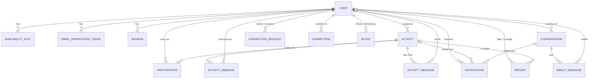

# Data Model

> Status: **planned**. The model uses PostgreSQL through Prisma ([ADR-0005](adr/0005-postgresql-with-prisma.md)). Each table is created by the roadmap milestone that first needs it (shown as **[Mx]**).

Conventions: `snake_case` tables and columns (mapped to camelCase in Prisma with `@map`), `uuid` primary keys, and `timestamptz` (UTC) for every instant. Every table that can change has `created_at` and `updated_at`.

## ER diagram

## Enums

| Enum | Values | Source |
|---|---|---|
| `ActivityType` | `STUDY`, `SPORTS`, `FOOD`, `SOCIAL`, `GAMING` | The five types in the UI mockups ([Q4](open-questions.md#q4-activity-type-list), decided 2026-10-27) |
| `ActivityStatus` | `OPEN`, `FULL`, `CANCELLED`, `COMPLETED` | FR18 |
| `UserStatus` | `PENDING_VERIFICATION`, `ACTIVE` | FR03–FR04 |
| `Role` | `STUDENT`, `ADMIN` | FR53 |
| `ActivityMessageKind` | `MESSAGE`, `UPDATE` | FR36, FR39 |
| `NotificationType` | `ACTIVITY_CHANGED`, `ACTIVITY_CANCELLED`, `ACTIVITY_UPDATE`, `REMOVED_FROM_ACTIVITY`, `PARTICIPANT_JOINED`, `PARTICIPANT_LEFT`, `CONNECTION_REQUEST`, `CONNECTION_ACCEPTED`, `DIRECT_MESSAGE` | FR32, FR34, FR39–FR41, FR45–FR46, FR49 |
| `ReportReason` | `HARASSMENT`, `SPAM`, `INAPPROPRIATE_CONTENT`, `SAFETY_CONCERN`, `OTHER` | FR51 |
| `ReportStatus` | `PENDING`, `REVIEWED` | FR52–FR53 |

## Entities

### `user` [M1]

| Column | Type | Constraints / notes | FR |
|---|---|---|---|
| `id` | uuid | PK | |
| `email` | text | **unique**; `CHECK (email = lower(email) AND email LIKE '%_@sjsu.edu')`. Never in public DTOs | FR01, FR04, FR13 |
| `password_hash` | text | | FR02, FR09 |
| `display_name` | varchar(50) | 1–50 characters | FR02 |
| `interests` | `ActivityType[]` | at least 1 element: `CHECK (interests IS NOT NULL AND cardinality(interests) >= 1)` (Prisma creates list columns as nullable) | FR02 |
| `role` | Role | default `STUDENT` | FR53 |
| `status` | UserStatus | default `PENDING_VERIFICATION` | FR03–FR04 |
| `failed_login_count` | smallint | default 0 | FR11 |
| `first_failed_login_at` | timestamptz null | start of the 15-minute window | FR11 |
| `locked_until` | timestamptz null | | FR11 |
| `created_at`, `updated_at` | timestamptz | `updated_at` = "last-updated" | FR06 |

### `availability_slot` [M1]

| Column | Type | Constraints / notes | FR |
|---|---|---|---|
| `id` | uuid | PK | |
| `user_id` | uuid | FK → user, **ON DELETE CASCADE** | FR08a |
| `day_of_week` | smallint | 0 (Sun) – 6 (Sat); `CHECK` | FR02 |
| `start_minute` | smallint | 0–1439, campus-local wall-clock time; `CHECK` | FR02 |
| `end_minute` | smallint | `CHECK (end_minute > start_minute)` | FR02 |

At least one slot per user is enforced in the service (FR02, FR06). Editing the profile replaces the whole set of slots in one transaction.

### `email_verification_token` [M1]

| Column | Type | Constraints / notes | FR |
|---|---|---|---|
| `id` | uuid | PK | |
| `user_id` | uuid | FK → user, CASCADE | |
| `token_hash` | char(64) | unique; SHA-256 of the emailed token | FR03 |
| `expires_at` | timestamptz | created + 24 h | FR03 |
| `used_at` | timestamptz null | | FR04 |

### `session` [M2]

| Column | Type | Constraints / notes | FR |
|---|---|---|---|
| `id` | uuid | PK | |
| `token_hash` | char(64) | unique | FR09 |
| `user_id` | uuid | FK → user, CASCADE | FR08e |
| `created_at` | timestamptz | | |
| `last_seen_at` | timestamptz | idle limit 30 min | FR10 |

### `connection` [M3]

| Column | Type | Constraints / notes | FR |
|---|---|---|---|
| `user_a_id` | uuid | FK → user, CASCADE | |
| `user_b_id` | uuid | FK → user, CASCADE; `CHECK (user_a_id < user_b_id)` stores each pair once | FR46 |
| `created_at` | timestamptz | | |

PK `(user_a_id, user_b_id)`. This table is created in M3 so `common/relationships` exists from the start. It stays empty until M9.

### `block` [M3]

| Column | Type | Constraints / notes | FR |
|---|---|---|---|
| `blocker_id` | uuid | FK → user, CASCADE | FR54 |
| `blocked_id` | uuid | FK → user, CASCADE; `CHECK (blocker_id <> blocked_id)` | FR54 |
| `created_at` | timestamptz | | |

PK `(blocker_id, blocked_id)`. Created in M3 and stays empty until M12. Every feature built in between already runs block checks against it, so they never have to be added later.

### `activity` [M4]

| Column | Type | Constraints / notes | FR |
|---|---|---|---|
| `id` | uuid | PK ("unique identifier") | FR28 |
| `organizer_id` | uuid null | FK → user, **ON DELETE SET NULL**. Null only after the organizer deletes their account | FR08 |
| `title` | varchar(100) | 1–100 | FR26 |
| `description` | varchar(500) | 1–500 | FR26 |
| `type` | ActivityType | | FR26 |
| `start_at` | timestamptz | in the future when created or edited (service) | FR27 |
| `end_at` | timestamptz | `CHECK (end_at > start_at)`; same campus-local date (service) | FR27 |
| `location` | varchar(100) | 1–100 | FR26 |
| `participant_limit` | smallint | `CHECK (participant_limit BETWEEN 2 AND 100)` | FR26 |
| `participant_count` | smallint | default 1; `CHECK (participant_count >= 0 AND participant_count <= participant_limit)` | FR22, FR28, FR30 |
| `status` | ActivityStatus | default `OPEN` | FR18, FR20 |
| `cancellation_reason` | varchar(200) null | | FR31 |
| `created_at`, `updated_at` | timestamptz | `updated_at` = "last-updated" | FR30 |

### `participation` [M4]

| Column | Type | Constraints / notes | FR |
|---|---|---|---|
| `activity_id` | uuid | FK → activity, CASCADE | |
| `user_id` | uuid | FK → user, CASCADE | FR08b |
| `is_organizer` | boolean | true for the creator's row | FR19, FR28 |
| `joined_at` | timestamptz | | DFD "join_time" |

PK `(activity_id, user_id)` prevents joining twice (FR21c). **This row also grants chat access** (FR22, FR35). There is no separate chat-access table, so access can't fall out of sync with membership.

### `activity_removal` [M6]

| Column | Type | Constraints / notes | FR |
|---|---|---|---|
| `activity_id` | uuid | FK → activity, CASCADE | |
| `user_id` | uuid | FK → user, CASCADE | |
| `reason` | varchar(200) null | null for block removals | FR33, FR56 |
| `removed_at` | timestamptz | | |

PK `(activity_id, user_id)`. If a row exists, that student cannot join that activity again (FR21d, FR34).

### `notification` [M4]

| Column | Type | Constraints / notes | FR |
|---|---|---|---|
| `id` | uuid | PK | |
| `recipient_id` | uuid | FK → user, CASCADE | FR08a |
| `type` | NotificationType | | FR42 |
| `activity_id` | uuid null | FK → activity, SET NULL (link) | FR42 |
| `activity_title` | varchar(100) null | snapshot of the title when the notification was created | FR42 |
| `conversation_id` | uuid null | FK → conversation, CASCADE (DM link) | FR49 |
| `actor_id` | uuid null | FK → user, SET NULL (who joined, requested or messaged) | |
| `body` | varchar(500) null | cancellation or removal reason, update text | FR32, FR34, FR39 |
| `read_at` | timestamptz null | null = unread | FR42 |
| `created_at` | timestamptz | ordered newest first | FR42 |

`conversation_id` is added in M10, when `conversation` exists.

### `activity_message` [M8]

| Column | Type | Constraints / notes | FR |
|---|---|---|---|
| `id` | uuid | PK | |
| `seq` | bigserial | Insertion order. The chat is ordered by it (oldest → newest) and the `?after=` polling cursor uses it, so messages with the same timestamp keep their order | FR36 |
| `activity_id` | uuid | FK → activity, CASCADE | FR35 |
| `sender_id` | uuid null | FK → user, **SET NULL**. Null is shown as "Deleted Student" | FR08d |
| `kind` | ActivityMessageKind | `UPDATE` is labeled "Update" | FR39 |
| `body` | varchar(500) | 1–500; `CHECK (char_length(btrim(body)) >= 1)` (Q18) | FR36, FR38 |
| `created_at` | timestamptz | shown as the message time | FR36 |

### `connection_request` [M9]

| Column | Type | Constraints / notes | FR |
|---|---|---|---|
| `id` | uuid | PK | |
| `sender_id` | uuid | FK → user, CASCADE | FR45 |
| `recipient_id` | uuid | FK → user, CASCADE; `CHECK (sender_id <> recipient_id)` | FR45 |
| `created_at` | timestamptz | | |

A unique index on `(LEAST(sender_id, recipient_id), GREATEST(sender_id, recipient_id))` allows only one pending request per pair, in either direction (FR45). Accepting or declining deletes the row (FR46).

### `conversation` and `direct_message` [M10]

| `conversation` column | Type | Constraints / notes | FR |
|---|---|---|---|
| `id` | uuid | PK | |
| `user_a_id`, `user_b_id` | uuid | FK → user, CASCADE; unique pair; `CHECK (user_a_id < user_b_id)` | FR47 |
| `last_message_at` | timestamptz null | used to order the conversation list | FR49 |

| `direct_message` column | Type | Constraints / notes | FR |
|---|---|---|---|
| `id` | uuid | PK | |
| `conversation_id` | uuid | FK → conversation, CASCADE | |
| `sender_id` | uuid null | FK → user, SET NULL | FR08d |
| `body` | varchar(500) | 1–500 | FR47 |
| `created_at` | timestamptz | | FR47 |

The conversation row is kept if the connection ends, but nobody can read or send messages without an **active** `connection` (FR48).

### `report` [M11]

| Column | Type | Constraints / notes | FR |
|---|---|---|---|
| `id` | uuid | PK | |
| `reporter_id` | uuid null | FK → user, SET NULL | FR52 |
| `target_user_id` | uuid null | FK → user, SET NULL | FR50 |
| `target_activity_id` | uuid null | FK → activity, SET NULL | FR50 |
| `reason` | ReportReason | required | FR51 |
| `description` | varchar(500) null | | FR51 |
| `status` | ReportStatus | default `PENDING` | FR52 |
| `reviewed_by_id` | uuid null | FK → user, SET NULL | FR53 |
| `reviewed_at` | timestamptz null | | FR53 |
| `created_at` | timestamptz | submission time | FR52 |

On insert, the service requires exactly one target. That can't be a plain `CHECK`, because a target may later be set to null when its account or activity is deleted.
Partial unique indexes prevent a second pending report on the same target (FR51):
`UNIQUE (reporter_id, target_user_id) WHERE status = 'PENDING'` and `UNIQUE (reporter_id, target_activity_id) WHERE status = 'PENDING'`.

## Delete behavior summary (FR08)

| When a `user` is deleted | Effect |
|---|---|
| availability, tokens, sessions, connections, requests, blocks, notifications, participation, removals | **CASCADE** (deleted) |
| `activity_message.sender_id`, `direct_message.sender_id` | **SET NULL** → shown as "Deleted Student" |
| `activity.organizer_id` (past activities; upcoming ones are cancelled first) | **SET NULL** |
| `report.reporter_id` / `target_user_id` / `reviewed_by_id` | **SET NULL** (so the report history survives) |

## Important indexes

| Index | Used by |
|---|---|
| `user (email)` unique | Registration, login (FR01, FR09) |
| `user USING gin (interests)` | Discover students (FR43) |
| `availability_slot (user_id, day_of_week)` | Recommendations (FR14d) |
| `session (token_hash)` unique, `session (user_id)` | Per-request lookup; deleting sessions on account removal |
| `activity (status, start_at)` | Search, recommendations, the Completed job (FR14–FR17, FR20) |
| `activity (organizer_id, start_at)` | My plans; account removal; block removal (FR08, FR56) |
| `participation (user_id)` | My plans; excluding joined activities from recommendations |
| `notification (recipient_id, created_at DESC)` | Notification list (FR42) |
| `notification (recipient_id) WHERE read_at IS NULL` | Unread count (FR42). Added in M7 with the unread-count endpoint (a partial index Prisma doesn't model, so check for migration drift then) |
| `activity_message (activity_id, seq)` | Chat history and polling (FR36) |
| `direct_message (conversation_id, created_at)` | DM history (FR47) |
| `block (blocked_id)` | Reverse block lookups (FR57) |
| Pair unique indexes on `connection_request`, `conversation` | FR45, FR47 |

Location search (FR16) uses `ILIKE '%text%'` in the search query, with `%`, `_` and `\` in the student's text escaped so they match literally. At campus scale a sequential scan over upcoming Open activities is fine, so no special text index is planned.

## Concurrency considerations

| Situation | Protection |
|---|---|
| Two students take the last spot at once (FR23) | One conditional `UPDATE activity … WHERE status='OPEN' AND participant_count < participant_limit AND start_at > now() RETURNING` inside the join transaction. PostgreSQL row locks make the second update re-read the row and match 0 rows → `ACTIVITY_FULL`. The `CHECK (participant_count <= participant_limit)` constraint is a final safety net ([ADR-0010](adr/0010-atomic-join-for-capacity.md)) |
| The same student double-clicks Join | `participation` PK `(activity_id, user_id)`. The second insert fails, the transaction rolls back (including the count increment), and the API returns `ALREADY_PARTICIPANT` |
| Leave or remove at the same time as a join | Leave and remove use `UPDATE … SET participant_count = participant_count - 1, status = CASE WHEN status='FULL' THEN 'OPEN' ELSE status END` in the same transaction as the participation delete, so the row lock orders them correctly (FR25, FR34) |
| Organizer lowers the limit while someone joins (FR30) | The edit runs `UPDATE … WHERE participant_count <= :newLimit` and returns `LIMIT_BELOW_COUNT` if 0 rows match. Status is recomputed in the same statement |
| Organizer cancels while someone joins | Join requires `status='OPEN'` and cancel sets `CANCELLED` on the same row, so whichever commits second sees the other's result |
| Two pending connection requests in opposite directions (FR45) | Pair unique index. The second insert returns `CONNECTION_NOT_ALLOWED` |
| Accepting a request twice | Accept deletes the request and inserts the connection in one transaction. A second accept finds no request → `NOT_FOUND` |
| Duplicate pending report (FR51) | Partial unique index |
| Denormalized `participant_count` drifts | Only changed in the same transaction as participation inserts and deletes. The invariant `participant_count = COUNT(participation)` is a planned integration-test assertion |

## Seed data (M4)

`npm run db:seed` (`apps/api/prisma/seed.ts`, roadmap task 67) adds development demo data:

- 7 active students (`maya.chen`, `alex.rivera`, `jordan.lee`, `priya.nair`, `sam.kim`, `lena.tran`, `sammy.spartan` `@sjsu.edu`), all with the password `goSpartans1`, with different interests and availability
- 5 activities dated relative to today: Midterm Study Group (5/8, like mockup p.4), Pickup Soccer, Coffee & Meet New Friends, a Full game night, and a Completed lunch from yesterday

It runs in one transaction, does nothing if the demo accounts already exist, refuses if only some of them exist, and refuses when `NODE_ENV=production`. Administrator accounts are not seeded until Q14 is decided (task 121). This is **demo data**, not test data: the product test data belongs to the team's testing assignment.
