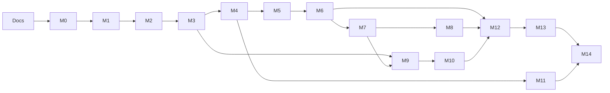

# Roadmap & Milestones

> Status: **planned**. No milestone has started. Implementation starts only after the team approves the documentation (tasks 1–2).

This roadmap follows the [architecture](architecture.md). Each milestone delivers a thin, working vertical slice: database → API → UI. FR coverage per milestone is in [traceability.md](traceability.md).

## How to read this roadmap

- **Tasks are numbered globally (1, 2, 3, …)** so they can be copied straight into the course **Product Backlog** table (*Number · Task Name · Assigned To · Completed By*). The roadmap tracks only number, name, dependencies and status; the Product Backlog adds who is assigned and who completed each task.
- **Status** is one of `Not started`, `In progress`, `In review` (implemented, PR not merged yet), `Done`, `Cancelled`. A task is never marked Done until it is merged and meets the definition of done. **Cancelled tasks stay in the table** with status `Cancelled` and a short note. They are never deleted.
- Each task should be about **one pull request**, reviewable in under 30 minutes.
- "Automated tests" tasks only add a few key Vitest/Supertest tests for the new code. The **comprehensive product test cases are a separate team assignment** (task 137) and are not designed here.

### Definition of done (every task)

1. It builds, and lint, type-check and tests pass in CI.
2. It follows the module and layer rules ([architecture §4–5](architecture.md#4-backend-modular-monolith)).
3. Validation uses the shared Zod schemas, and errors use the standard envelope.
4. Docs are updated if the API, data model or a decision changed, and traceability is updated.
5. UI changes work at phone, tablet and desktop widths with no horizontal scrolling ([architecture §12.3](architecture.md#123-styling-and-responsive-layout)).
6. A teammate reviewed and approved the PR.

### Milestone overview

| Milestone | Objective | FRs |
|---|---|---|
| [Docs](#planning--architecture-documentation) | Architecture & planning documentation | – |
| [M0](#m0--project-foundation) | Project foundation: skeleton apps, database, CI | – |
| [M1](#m1--registration--email-verification) | Registration & email verification | FR01–FR04 |
| [M2](#m2--login-sessions--lockout) | Login, sessions & lockout | FR09–FR11 |
| [M3](#m3--profiles--relationship-policy) | Profiles & relationship policy | FR05–FR06, FR12–FR13 |
| [M4](#m4--activities-create-view-edit-lifecycle) | Activities: create, view, edit, lifecycle | FR18, FR20, FR26–FR30, FR40a |
| [M5](#m5--finding-activities) | Finding activities: Recommended & search | FR14–FR17 |
| [M6](#m6--joining-leaving--participants) | Joining, leaving & participants | FR19, FR21–FR25, FR33–FR34, FR41 |
| [M7](#m7--cancellation--notifications) | Cancellation & notifications | FR31–FR32, FR40b, FR42 |
| [M8](#m8--activity-chat--organizer-updates) | Activity chat & organizer updates | FR35–FR39, FR40c |
| [M9](#m9--student-discovery--connections) | Student discovery & connections | FR43–FR46 |
| [M10](#m10--direct-messages) | Direct messages | FR47–FR49 |
| [M11](#m11--reporting--administrator-review) | Reporting & administrator review | FR50–FR53 |
| [M12](#m12--blocking) | Blocking | FR54–FR57 |
| [M13](#m13--account-removal) | Account removal | FR07–FR08 |
| [M14](#m14--testing-stabilization--release) | Testing, stabilization & release | all |

Account removal (M13) comes last on purpose. It has to undo data from every other module (FR08). Blocking (M12) comes late for the same reason, but the `block` table and `common/relationships` exist from **M3**, so each feature builds in its block checks from the start instead of having them retrofitted.

M9–M11 depend only on what their arrows show. With four people, M9/M10 and M11 can run alongside M5–M8.

---

## Planning — Architecture documentation

**Objective:** agree on the architecture before any code is written.
**Dependencies:** course deliverables (Proposal, HLR, FR, Design, UI).
**Files:** `README.md`, `docs/**`.
**Completion criteria:** the team has reviewed every doc, the ADRs are marked Accepted (or revised), and the open questions needed for M0–M2 are decided.

| # | Task Name | Depends on | Status |
|---|---|---|---|
| 1 | Draft architecture & planning docs (README, architecture, data model, API, ADRs, roadmap, traceability, open questions) | – | In progress (drafted, awaiting review) |
| 2 | Team review of docs; mark ADRs Accepted or revise; record decisions in open-questions.md | 1 | Not started |
| 3 | Decide which hosting/tooling accounts the team needs (GitHub repo access for all members, branch protection rights) | 2 | Not started |

---

## M0 — Project foundation

**Objective:** a runnable, empty, well-structured project. Every later task only adds features.
**Features included:** no user features. `GET /api/v1/health`, the app shell with four bottom tabs, and CI.
**Dependencies:** task 2.
**Expected files/modules:**
`package.json` (workspaces), `.nvmrc`, `.gitignore`, `.editorconfig`, `tsconfig.base.json`, ESLint/Prettier config,
`packages/shared/src/{index,enums,constants,messages}.ts`,
`docker-compose.yml`, `docker/postgres/init.sql`, `apps/api/.env.example`,
`apps/api/src/{app,server,db,routes,health}.ts`, `apps/api/src/config/env.ts`, `apps/api/src/common/{errors,errorHandler,validate}.ts`, `apps/api/prisma/{schema.prisma,seed.ts}`, `apps/api/prisma.config.ts`,
`apps/web/{index.html,vite.config.ts}`, `apps/web/src/{main.tsx,app/App.tsx,app/router.tsx,app/providers.tsx,app/layouts/{AppShell,PageHeader}.tsx,lib/apiClient.ts,lib/queryKeys.ts,styles/{tokens,global}.css,components/*,features/*/ (placeholder pages)}`,
`vitest.config.ts` (per workspace), `apps/api/test/health.test.ts`, `.github/workflows/ci.yml`, `.github/pull_request_template.md`.

| # | Task Name | Depends on | Status |
|---|---|---|---|
| 4 | Initialize npm workspaces root: `package.json`, `.nvmrc` (Node LTS), `.gitignore`, `.editorconfig`, strict `tsconfig.base.json` | 2 | In review (implemented, not merged) |
| 5 | Add ESLint + Prettier configs and root `lint`, `format`, `typecheck` scripts | 4 | In review (implemented, not merged) |
| 6 | Create `packages/shared` skeleton (`enums.ts`, `constants.ts`, `messages.ts`, `index.ts`; depends only on `zod`) | 4 | In review (implemented, not merged) |
| 7 | Add `docker-compose.yml` with pinned PostgreSQL, a volume, and an init script that creates the dev and test databases; add `.env.example` | 4 | In review (implemented, not merged) |
| 8 | Create `apps/api` skeleton: Express 5 `createApp()` in `app.ts`, `server.ts`, Zod-validated `config/env.ts`, JSON body parsing, `cookie-parser`, `helmet` | 4, 6 | In review (implemented, not merged) |
| 9 | Add `common/errors.ts` (AppError family), `errorHandler.ts` (JSON error envelope, 404 fallback) and `validate.ts` middleware | 8 | In review (implemented, not merged) |
| 10 | Initialize Prisma: datasource and generator, `db.ts` singleton, scripts `db:migrate`, `db:reset`, `db:seed` (empty seed) | 7, 8 | In review (implemented, not merged) |
| 11 | Add `GET /api/v1/health` that checks the database | 9, 10 | In review (implemented, not merged) |
| 12 | Create `apps/web` with Vite + React + TypeScript; dev proxy `/api` → API | 4, 6 | In review (implemented, not merged) |
| 13 | Add React Router with `AppShell` (logo header, bottom nav: Discover · My plans · Inbox · Profile) and placeholder pages | 12 | In review (implemented, not merged) |
| 14 | Add TanStack Query provider, `lib/apiClient.ts` (credentials, JSON, `ApiError`) and `lib/queryKeys.ts` | 12 | In review (implemented, not merged) |
| 15 | Add `styles/tokens.css` (mockup colors, radii, font) and base components: Button, TextField, Chip, Card, EmptyState | 12 | In review (implemented, not merged) |
| 16 | **Test infrastructure only:** configure Vitest in every workspace and Supertest against `createApp()` using the test DB; add one `/health` smoke test | 10, 11 | In review (implemented, not merged) |
| 17 | Add GitHub Actions CI: install, lint, typecheck, build, test with a PostgreSQL service container | 5, 16 | In review (implemented, not merged) |
| 18 | Protect `main` (PR required, 1 approval, CI must pass); add a PR template with the definition-of-done checklist | 17 | In progress (PR template added; branch protection still to be set in GitHub settings) |
| 19 | Update README "Planned setup" to the real commands and mark M0 status | 11, 13, 17 | In review (implemented, not merged) |

**Completion criteria:** a fresh clone works with the README commands. `/api/v1/health` returns `ok`. The web app shows the shell and four tabs. CI is green on a PR. No feature code yet.

---

## M1 — Registration & email verification

**Objective:** a new student can register with an `@sjsu.edu` email, verify it, and end up with an active profile.
**Features included:** FR01–FR04.
**Dependencies:** M0. Decisions Q4 (activity types), Q15 (re-registration), Q26 (password hash).
**Expected files/modules:** Prisma migration (`user`, `availability_slot`, `email_verification_token`); `packages/shared/src/{schemas/auth,time,validation}.ts`; `apps/api/src/common/{time,email,crypto,password}.ts`, `apps/api/src/deps.ts`; `apps/api/src/modules/auth/*`; `apps/api/test/{globalSetup,helpers,auth.test}.ts`; `apps/web/src/features/auth/{RegisterPage,CheckEmailPage,VerifyEmailPage,ResendLinkForm,api}.tsx`; `apps/web/src/features/profile/{AvailabilityEditor,InterestPicker}.tsx`; `apps/web/src/app/layouts/AuthLayout.tsx`; `apps/web/src/lib/zodForm.ts`.

| # | Task Name | Depends on | Status |
|---|---|---|---|
| 20 | Team decisions: Q4 activity type list, Q15 re-registration, Q26 password hashing | 2 | Done (decided 2026-10-27: UI five types; reject + offer resend; argon2) |
| 21 | Prisma migration: `user` (incl. lockout columns), `availability_slot`, `email_verification_token` with CHECK constraints | 10, 20 | In review (implemented, not merged) |
| 22 | Shared: `ActivityType`/`UserStatus`/`Role` enums, limits in `constants.ts`, `registerSchema` (domain, password rule, display name, interests ≥ 1, slots with end > start) | 6, 20 | In review (implemented, not merged) |
| 23 | `common/time.ts`: injectable `clock`, `HH:mm` ↔ minute-of-day helpers | 8 | In review (implemented, not merged) |
| 24 | `common/email.ts`: Nodemailer transport (console in dev, SMTP in prod) and verification email template | 8 | In review (implemented, not merged) |
| 25 | `auth.repository`: create pending user with slots and token hash; find by email; find a valid token | 21 | In review (implemented, not merged) |
| 26 | `auth.service.register`: `@sjsu.edu` check, duplicate check, hash password, store, send link (FR01–FR03) | 22–25 | In review (implemented, not merged) |
| 27 | `auth.service.verifyEmail` and `resendVerification`: single-use, 24-hour expiry, activate account (FR03–FR04) | 26 | In review (implemented, not merged) |
| 28 | Routes and controller: `POST /auth/register`, `/auth/verify-email`, `/auth/resend-verification` | 26, 27 | In review (implemented, not merged) |
| 29 | Web: `AvailabilityEditor` (add/remove rows of day + start + end) | 15, 22 | In review (implemented, not merged) |
| 30 | Web: `RegisterPage` with interest chips, availability editor and per-field errors (FR02) | 28, 29 | In review (implemented, not merged) |
| 31 | Web: `CheckEmailPage` (with resend) and `VerifyEmailPage` (reads the token from the URL) | 28 | In review (implemented, not merged) |
| 32 | Automated tests (key cases): `registerSchema` unit tests; register/verify integration tests | 28 | In review (implemented, not merged) |

**Completion criteria:** only `@sjsu.edu` can register, and a duplicate email is rejected with the reason. Each invalid field is identified. The dev console shows the link. An expired link is rejected and a new one can be requested. Verification activates the account. The email is stored but not exposed.

---

## M2 — Login, sessions & lockout

**Objective:** verified students can log in and out, sessions expire after 30 idle minutes, and repeated failures lock the account.
**Features included:** FR09–FR11.
**Dependencies:** M1. Decisions Q8 (login layout), Q16 (lockout/enumeration).
**Expected files/modules:** Prisma migration (`session`); `apps/api/src/common/{auth,originCheck}.ts`; `apps/api/src/modules/auth/{session.service,auth.middleware,auth.cookies,auth.lockout}.ts` plus login/logout/me in the existing auth files; `apps/api/test/login.test.ts`; `apps/web/src/features/auth/LoginPage.tsx`; `apps/web/src/app/RequireAuth.tsx`; global 401 handling in `app/providers.tsx`.

| # | Task Name | Depends on | Status |
|---|---|---|---|
| 33 | Team decisions: Q8 login layout, Q16 lockout & enumeration details | 2 | Done (decided 2026-10-27: one form; locked accounts told; only real accounts counted; no IP limit) |
| 34 | Prisma migration: `session` table | 21 | In review (implemented, not merged) |
| 35 | `auth.repository` session functions: create (hashed token), resolve, slide `last_seen_at`, delete | 34 | In review (implemented, not merged) |
| 36 | `common/auth.ts`: session middleware (`req.user`, 30-minute idle), `requireAuth`, `requireAdmin`, Origin check on non-GET | 35 | In review (implemented, not merged) |
| 37 | `auth.service.login`: generic invalid-credentials error, unverified rejection, 5-in-15-minute lockout using `clock` (FR09, FR11) | 35, 33 | In review (implemented, not merged) |
| 38 | `auth.service.logout`; routes `POST /auth/login`, `POST /auth/logout`, `GET /auth/me` | 36, 37 | In review (implemented, not merged) |
| 39 | Web: `LoginPage` (mockup p.1) with invalid, unverified and locked states; link to Create account | 38 | In review (implemented, not merged) |
| 40 | Web: auth guard using the `['me']` query, `/login?next=` redirect, global 401 handling, Log out on Profile tab | 38, 14 | In review (implemented, not merged) |
| 41 | Automated tests (key cases): lockout and idle-timeout unit tests with a fake clock; login integration | 38 | In review (implemented, not merged) |

**Completion criteria:** login works only for verified accounts with the correct password, and the error is generic. The lock engages after 5 failures and clears after 15 minutes or a successful login. A session idle for 30 minutes requires logging in again. Every route except registration and login redirects logged-out users.

---

## M3 — Profiles & relationship policy

**Objective:** students can view and edit their own profile and view other students' profiles. The shared block/connection policy exists.
**Features included:** FR05–FR06, FR12–FR13 (the profile's Connect, Report and Block actions arrive in M9, M11 and M12).
**Dependencies:** M2.
**Expected files/modules:** Prisma migration (`block`, `connection`); `apps/api/src/common/relationships.ts`; `apps/api/src/modules/users/{users.routes,users.controller,users.service,users.mappers}.ts` (no repository: simple queries); `apps/api/test/users.test.ts`; `packages/shared/src/schemas/profile.ts`, `dto/profile.ts`; `apps/web/src/features/profile/{MyProfilePage,EditProfilePage,InterestTags,AvailabilityList,api}.tsx`; `apps/web/src/features/people/StudentProfilePage.tsx`; `apps/web/src/components/Avatar.tsx`; `apps/web/src/lib/format.ts`.

| # | Task Name | Depends on | Status |
|---|---|---|---|
| 42 | Prisma migration: `block` and `connection` tables (stay empty until M12/M9) | 21 | In review (implemented, not merged) |
| 43 | `common/relationships.ts`: `isBlockedEitherWay`, `blockedIdsFor`, `areConnected` | 42 | In review (implemented, not merged) |
| 44 | Shared: `profileUpdateSchema`, `OwnProfileDto`, `PublicProfileDto` (no email field) | 22 | In review (implemented, not merged) |
| 45 | `users.mappers`: own vs public profile; shared-interest marking | 44 | In review (implemented, not merged) |
| 46 | `users.service`: get own profile; update (validate, replace slots in a transaction, `updated_at`); get public profile (404 when blocked; `connectionState`) | 43, 45 | In review (implemented, not merged) |
| 47 | Routes: `GET /users/me`, `PATCH /users/me`, `GET /users/:id` | 46 | In review (implemented, not merged) |
| 48 | Web: `MyProfilePage` (FR12): name, email, interests, availability, Edit and Log out | 47 | In review (implemented, not merged) |
| 49 | Web: `EditProfilePage` reusing `AvailabilityEditor`, per-field errors, nothing saved on error (FR05–FR06) | 47, 29 | In review (implemented, not merged) |
| 50 | Web: `StudentProfilePage` (FR13) with shared interests highlighted, no email | 47 | In review (implemented, not merged) |
| 51 | Automated tests (key cases): public mapper never includes email; profile update validation | 47 | In review (implemented, not merged) |

**Completion criteria:** own profile shows the email and other profiles never do. Edits validate with the registration rules, update in place and record `updated_at`. A blocked pair gets 404 (verifiable only by inserting a block row in a test until M12).

---

## M4 — Activities: create, view, edit, lifecycle

**Objective:** students can create activities, view details and edit their own. Activities move to Completed automatically.
**Features included:** FR18, FR20, FR26–FR30, FR40a (change notifications are stored; the UI comes in M7).
**Dependencies:** M3. Decisions Q2, Q3, Q5, Q6, Q20.
**Expected files/modules:** Prisma migration (`activity`, `participation`, `notification`); `packages/shared/src/{schemas/activity,dto/activity,time}.ts` (campus-time conversion); `apps/api/src/modules/activities/{activities.routes,activities.controller,activity.service,activities.repository,activities.mappers}.ts`; `apps/api/src/modules/notifications/notifications.service.ts`; `apps/api/src/jobs/completeActivities.ts`; `apps/api/prisma/seed.ts`; `apps/api/test/activities.test.ts`; `apps/web/src/features/activities/*`; `apps/web/src/components/TextArea.tsx`.

| # | Task Name | Depends on | Status |
|---|---|---|---|
| 52 | Team decisions: Q2 create-form fields, Q3 single type, Q5 location input, Q6 images, Q20 timezone | 2 | Done (decided 2026-10-27: follow FR26; one type; free-text location; illustration per type; America/Los_Angeles) |
| 53 | Prisma migration: `activity` (CHECKs), `participation`, `notification`, with indexes from data-model.md | 42, 52 | In review (implemented, not merged) |
| 54 | Shared: `activityCreateSchema`, `activityUpdateSchema`, `ActivityStatus`/`NotificationType` enums, `ActivityCardDto`/`ActivityDetailDto` | 22 | In review (implemented, not merged) |
| 55 | `common/time.ts`: campus-local date + time → UTC (handles daylight saving), same-date check | 23 | In review (implemented, not merged) |
| 56 | `notifications.service.create(tx, …)` / `createMany` (backend only) | 53 | In review (implemented, not merged) |
| 57 | `activities.repository`: insert activity + organizer participation; find with viewer participation; conditional update with limit guard and status recompute | 53 | In review (implemented, not merged) |
| 58 | `activity.service.create` (FR26–FR28) | 54, 55, 57 | In review (implemented, not merged) |
| 59 | `activity.service.getDetail`: visibility (FR18, FR20), capability flags; `activities.mappers` (derived Completed, "Deleted Student") | 57 | In review (implemented, not merged) |
| 60 | `activity.service.update`: organizer only, Open/Full and not started, limit ≥ count, status recompute, notify participants when title, type, date, times or location change (FR29–FR30, FR40a) | 56, 57 | In review (implemented, not merged) |
| 61 | `jobs/completeActivities.ts` + start it from `server.ts` (FR20) | 53 | In review (implemented, not merged) |
| 62 | Routes: `POST /activities`, `GET /activities/:id`, `PATCH /activities/:id` | 58–60 | In review (implemented, not merged) |
| 63 | Web components: `SpotsBar`, type chip, type illustration (`Avatar` exists since M3) | 15, 54 | In review (implemented, not merged; `ActivityCard` moved to task 74, where activity lists first appear) |
| 64 | Web: `CreateActivityPage` (mockup p.3 + FR26 fields) with participant stepper and per-field errors | 62, 63 | In review (implemented, not merged) |
| 65 | Web: `ActivityDetailPage` (mockup p.4), read-only; organizer sees Edit | 62, 63 | In review (implemented, not merged) |
| 66 | Web: `EditActivityPage` | 64, 65 | In review (implemented, not merged) |
| 67 | Dev seed: demo students and activities resembling the mockups (admin provisioning comes in task 121) | 62 | In review (implemented, not merged) |
| 68 | Automated tests (key cases): create/edit validation; status recompute with a fake clock; daylight-saving conversion unit tests | 62 | In review (implemented, not merged) |

**Completion criteria:** creating an activity stores it as Open with count 1 and the organizer as first participant. The detail view shows every FR18 field. Only the organizer can edit, only before the start, and a limit below the count is rejected. Ended activities show as Completed. Field changes create notifications for participants (visible in M7).

---

## M5 — Finding activities

**Objective:** students can find activities through the Recommended list and search.
**Features included:** FR14–FR17.
**Dependencies:** M4. Decisions Q1, Q9, Q10.
**Expected files/modules:** `activities.repository` (search, recommended); `activity.service`; `packages/shared/src/schemas/activitySearch.ts`; `apps/web/src/features/discover/{DiscoverPage,SearchPage,SearchFilters,ActivityList,api}.tsx`; `apps/web/src/features/activities/ActivityCard.tsx`; `apps/api/test/findActivities.test.ts`.

| # | Task Name | Depends on | Status |
|---|---|---|---|
| 69 | Team decisions: Q1 Discover meaning, Q9 search box behavior, Q10 Featured vs Recommended | 2 | Not started (M5 is built on the documented working assumptions until the team decides) |
| 70 | Shared: `activitySearchSchema` (type, date range, start-time range, location) | 54 | In review (implemented, not merged) |
| 71 | `activities.repository.search`: combined filters, Open + future, block exclusion, soonest first, paging (FR16–FR17) | 57, 43 | In review (implemented, not merged) |
| 72 | `activities.repository.recommended`: raw SQL with the six FR14 conditions (timezone-aware availability) | 57, 43 | In review (implemented, not merged) |
| 73 | `activity.service.search` / `recommended`; routes `GET /activities`, `GET /activities/recommended` | 71, 72 | In review (implemented, not merged) |
| 74 | Web: `ActivityCard` (moved from task 63) and `DiscoverPage` (mockup p.2): greeting, Create button, type chips, Recommended list, "No matching activities found." | 73, 69 | In review (implemented, not merged) |
| 75 | Web: `SearchPage` with FR16 filters stored in URL params, clearable criteria, "No activities found." | 73, 69 | In review (implemented, not merged) |
| 76 | Automated tests (key cases): one integration test per FR14 condition; combined search filters | 73 | In review (implemented, not merged) |

**Completion criteria:** Recommended shows only activities that meet all six FR14 conditions, soonest first, and reflects a profile edit on the next load. Search applies all entered criteria together, clearing one broadens the results, and empty criteria return everything allowed by FR17. Selecting a result opens its detail view.

---

## M6 — Joining, leaving & participants

**Objective:** students can join and leave activities safely under concurrency, and organizers can remove participants.
**Features included:** FR19, FR21–FR25, FR33–FR34, FR41; the My plans tab (FR18 entry point).
**Dependencies:** M5.
**Expected files/modules:** Prisma migration (`activity_removal`); `apps/api/src/modules/activities/participation.service.ts`; `activities.repository` (reserve/release spot); `apps/web/src/features/activities/{ParticipantList,JoinSuccessPage,ActivityFullPage}.tsx`; `apps/web/src/features/plans/MyPlansPage.tsx`.

| # | Task Name | Depends on | Status |
|---|---|---|---|
| 77 | Prisma migration: `activity_removal` | 53 | Not started |
| 78 | `activities.repository`: `reserveSpot` (atomic conditional UPDATE), `releaseSpot`, insert/delete participation, list participants | 77 | Not started |
| 79 | `participation.service.join`: FR21 checks (a–e) → reserve → insert → notify organizer, in one transaction (FR21–FR23, FR41) | 78, 56, 43 | Not started |
| 80 | `participation.service.leave`: non-organizer, Open/Full, not started; release spot; notify organizer (FR24–FR25, FR41) | 78 | Not started |
| 81 | `participation.service.removeParticipant`: organizer only, removal record, optional reason, notify the removed student (FR33–FR34) | 78, 77 | Not started |
| 82 | Routes: `GET /activities/:id/participants`, `POST …/join`, `POST …/leave`, `DELETE …/participants/:userId` | 79–81 | Not started |
| 83 | `GET /activities/mine` (joined/organizing × upcoming/past) | 57 | Not started |
| 84 | Web: `ParticipantList` on the detail page (avatars, full list, "Organizer" label, links to profiles) (FR19) | 82 | Not started |
| 85 | Web: Join button → `JoinSuccessPage` (p.6) or `ActivityFullPage` (p.5); show the other FR21 reasons inline | 82 | Not started |
| 86 | Web: Leave with a confirmation dialog; organizer Remove with confirmation and optional reason | 82 | Not started |
| 87 | Web: `MyPlansPage` (Joined / Organizing, Upcoming / Past) | 83 | Not started |
| 88 | Automated tests (key cases): parallel joins for the last spot → exactly one success (FR23); `participant_count` equals the number of rows; join-condition unit tests | 82 | Not started |

**Completion criteria:** a join succeeds only when all FR21 conditions hold. Simultaneous joins for the last spot admit exactly one student, and the rest see "This activity is full." The status flips Full ⇄ Open correctly. Removed students can't rejoin. The organizer gets join and leave notifications. My plans lists the student's activities.

---

## M7 — Cancellation & notifications

**Objective:** organizers can cancel, and students can see and read their notifications.
**Features included:** FR31–FR32, FR40b, FR42 (and the UI for every notification created so far).
**Dependencies:** M6. Decision Q21 (bell vs Inbox).
**Expected files/modules:** `activity.service.cancel`; `apps/api/src/modules/notifications/{notifications.routes,notifications.controller,notifications.service}.ts`; `apps/web/src/features/activities/CancelDialog.tsx`; `apps/web/src/features/inbox/NotificationsPage.tsx`; header bell in `AppShell.tsx`.

| # | Task Name | Depends on | Status |
|---|---|---|---|
| 89 | `activity.service.cancel`: organizer only, Open/Full and not started, reason ≤ 200, status Cancelled, notify all other participants; route `POST /activities/:id/cancel` (FR31–FR32) | 79 | Not started |
| 90 | Verify that Cancelled activities are excluded from search and recommendations, read-only, and visible only to their members (FR20, FR32) | 89 | Not started |
| 91 | `notifications.service`: list (newest first, paged), unread count, mark read; routes under `/notifications` (FR42) | 56 | Not started |
| 92 | Web: `CancelDialog` (confirmation + optional reason); "Cancelled" label on the detail page | 89 | Not started |
| 93 | Team decisions Q21 (bell vs Inbox) and Q27 (polling must not keep sessions alive); web: header bell with unread badge (30 s polling) and `NotificationsPage`; opening one marks it read and follows its link | 91 | Not started |
| 94 | Automated tests (key cases): who receives notifications on edit, cancel, join, leave and removal | 91 | Not started |

**Completion criteria:** cancelling notifies every other participant and is irreversible. The notification list is newest first with an unread count. Opening a notification marks it read and opens the related activity.

---

## M8 — Activity chat & organizer updates

**Objective:** participants can chat, and organizers can post labeled updates.
**Features included:** FR35–FR39, FR40c.
**Dependencies:** M7. Decisions Q18 (whitespace), Q22 (updates after start).
**Expected files/modules:** Prisma migration (`activity_message`); `packages/shared/src/schemas/message.ts`; `apps/api/src/modules/messages/{messages.routes,messages.controller,messages.service}.ts`; `apps/web/src/features/chat/ActivityChatPage.tsx`.

| # | Task Name | Depends on | Status |
|---|---|---|---|
| 95 | Team decisions: Q18 whitespace-only text, Q22 updates after start | 2 | Not started |
| 96 | Prisma migration: `activity_message` | 53 | Not started |
| 97 | Shared: `messageSchema` (1–500, trimmed), `ActivityMessageDto` | 95 | Not started |
| 98 | `messages.service`: list activity messages (current participants only, `after` cursor, hide blocked senders from the blocker); send (rejected when Cancelled/Completed) (FR35–FR37, FR55c) | 96, 97, 43 | Not started |
| 99 | `messages.service.postUpdate`: organizer only, Open/Full, kind UPDATE, notify the other participants (FR38–FR39, FR40c) | 98, 56 | Not started |
| 100 | Routes: `GET/POST /activities/:id/messages`, `POST /activities/:id/updates` | 98, 99 | Not started |
| 101 | Web: `ActivityChatPage` with 5 s polling, oldest first, sender name and time, "Update" label, "Deleted Student", read-only state | 100 | Not started |
| 102 | Web: organizer "Post update" composer; "Open group chat" on the detail page and on `JoinSuccessPage` | 101 | Not started |
| 103 | Automated tests (key cases): access lost after leaving or removal; read-only after cancel; update notifications | 100 | Not started |

**Completion criteria:** only current participants can read or send. Messages are 1–500 characters and listed oldest first. Updates are labeled and notify participants. The chat is read-only once the activity is Cancelled or Completed.

---

## M9 — Student discovery & connections

**Objective:** students find others with shared interests and connect with them.
**Features included:** FR43–FR46 (and the Connect action on profiles, FR13).
**Dependencies:** M3, M7. Decision Q1 (where the page lives).
**Expected files/modules:** Prisma migration (`connection_request`); `apps/api/src/modules/connections/*`; `apps/web/src/features/people/{DiscoverStudentsPage,ConnectionRequestsPage,api}.tsx`.

| # | Task Name | Depends on | Status |
|---|---|---|---|
| 104 | Prisma migration: `connection_request` with the pair unique index | 42 | Not started |
| 105 | `connections.repository`: discover query (shared-interest count, exclusions, ordering); pair helpers | 104, 43 | Not started |
| 106 | `connections.service`: discover; send request (FR45 rules, notify); accept (create connection, notify sender); decline (delete silently); list connections | 105, 56 | Not started |
| 107 | Routes: `/connections/discover`, `/connections/requests` (+ accept/decline), `/connections` | 106 | Not started |
| 108 | Web: `DiscoverStudentsPage` (shared interests, "No students found.") | 107 | Not started |
| 109 | Web: Connect button with `connectionState` on profile and discover; `ConnectionRequestsPage` with Accept/Decline | 107 | Not started |
| 110 | Automated tests (key cases): FR45 rejection rules; requests in opposite directions | 107 | Not started |

**Completion criteria:** the discover list excludes self, blocked and connected students, and is ordered by shared interests then name. Requests follow every FR45 rule. Accepting notifies the sender; declining doesn't.

---

## M10 — Direct messages

**Objective:** connected students can message each other one-to-one.
**Features included:** FR47–FR49.
**Dependencies:** M9.
**Expected files/modules:** Prisma migration (`conversation`, `direct_message`, `notification.conversation_id`); `messages.service` (DM functions); `apps/web/src/features/inbox/{ConversationsPage,ConversationPage}.tsx`.

| # | Task Name | Depends on | Status |
|---|---|---|---|
| 111 | Prisma migration: `conversation`, `direct_message`; add `notification.conversation_id` | 104 | Not started |
| 112 | `messages.service`: list conversations (most recent first); get thread and send (active connection required; create conversation if missing; update `last_message_at`; notify the recipient) | 111, 43, 56 | Not started |
| 113 | Routes: `GET /conversations`, `GET/POST /conversations/:userId/messages` | 112 | Not started |
| 114 | Web: Inbox tab → `ConversationsPage`; `ConversationPage` with polling; Message button on connected profiles | 113 | Not started |
| 115 | Automated tests (key cases): students who aren't connected can't read or send | 113 | Not started |

**Completion criteria:** only connected pairs can message. Messages are 1–500 characters with sender and time. The recipient is notified with a link to the conversation, and conversations are ordered by most recent message.

---

## M11 — Reporting & administrator review

**Objective:** students can report profiles and activities, and administrators review the reports.
**Features included:** FR50–FR53.
**Dependencies:** M3, M4. Decision Q14 (admin accounts).
**Expected files/modules:** Prisma migration (`report`); `packages/shared/src/schemas/report.ts`; `apps/api/src/modules/moderation/{moderation.routes,moderation.controller,reports.service}.ts`; `apps/web/src/features/moderation/ReportDialog.tsx`; `apps/web/src/features/admin/ReportsPage.tsx`.

| # | Task Name | Depends on | Status |
|---|---|---|---|
| 116 | Team decision Q14: how admin accounts are created | 2 | Not started |
| 117 | Prisma migration: `report` with partial unique indexes for pending reports | 53 | Not started |
| 118 | Shared: `ReportReason` enum, `reportSchema` | 6 | Not started |
| 119 | `reports.service.submit`: not own profile or activity, exactly one target, no duplicate pending, no notification to the target; `POST /reports` (FR50–FR52) | 117, 118 | Not started |
| 120 | `reports.service` admin list and mark Reviewed (records the admin and time); `/admin/reports` routes behind `requireAdmin` (FR53) | 117, 36 | Not started |
| 121 | Admin provisioning according to Q14 (seed or CLI script) | 116 | Not started |
| 122 | Web: `ReportDialog` on student profiles and activity details (hidden on your own) | 119 | Not started |
| 123 | Web: admin `ReportsPage` (filter by status, mark Reviewed) with an admin-only route guard | 120 | Not started |
| 124 | Automated tests (key cases): non-admins get 403; a duplicate pending report is rejected | 120 | Not started |

**Completion criteria:** a report needs a reason and is stored as Pending with all FR52 fields. The reporter gets a confirmation and nobody else is notified. Only administrators can view reports and mark them Reviewed.

---

## M12 — Blocking

**Objective:** students can block others, and the block applies everywhere.
**Features included:** FR54–FR57.
**Dependencies:** M6, M8, M9, M10. Decisions Q11 (unblock), Q12 (join message).
**Expected files/modules:** `apps/api/src/modules/moderation/blocks.service.ts`; `participation.service.removeForBlock`; `connections.service.removeBetween`; `apps/web/src/features/moderation/BlockDialog.tsx`.

| # | Task Name | Depends on | Status |
|---|---|---|---|
| 125 | Team decisions: Q11 unblock/disconnect, Q12 join-failure message | 2 | Not started |
| 126 | `connections.service.removeBetween` (end the connection, delete pending requests) | 106 | Not started |
| 127 | `participation.service.removeForBlock` (reuses removal; no reason in the notification) | 81 | Not started |
| 128 | `blocks.service.block`: no self-blocks; one transaction that inserts the block, ends the connection and requests, and removes the blocked student from the blocker's upcoming activities; no notification about the block; `POST /blocks` (FR54–FR56) | 126, 127 | Not started |
| 129 | Audit every read and write path against FR57 and FR55 using `common/relationships` (search, recommended, discover, profile 404, join, requests, DMs, chat filter); fix any gaps | 128 | Not started |
| 130 | Web: `BlockDialog` with confirmation on profiles; navigate away afterwards | 128 | Not started |
| 131 | Automated tests (key cases): each block side effect | 128 | Not started |

**Completion criteria:** every FR55–FR57 effect holds, and the blocked student is never told.

---

## M13 — Account removal

**Objective:** students can permanently remove their account, and every dependent record is handled.
**Features included:** FR07–FR08.
**Dependencies:** M6, M7, M8, M10, M12. Decision Q13.
**Expected files/modules:** `users.service.deleteAccount`; possibly a migration adjusting FK `ON DELETE` rules; `apps/web/src/features/profile/DeleteAccountDialog.tsx`.

| # | Task Name | Depends on | Status |
|---|---|---|---|
| 132 | Team decision Q13: account-removal side effects | 2 | Not started |
| 133 | Check every FK `ON DELETE` rule against the delete summary in data-model.md; add a migration if any differ | 111, 117 | Not started |
| 134 | `users.service.deleteAccount`: verify password; cancel upcoming organized activities; leave joined ones; delete the user; end the session; `DELETE /users/me` (FR07–FR08) | 89, 80, 133 | Not started |
| 135 | Web: `DeleteAccountDialog` (permanent warning + password) and the Delete action on `MyProfilePage` (FR07, FR12) | 134 | Not started |
| 136 | Automated tests (key cases): cascades, "Deleted Student" in chat, the same email can register again | 134 | Not started |

**Completion criteria:** after removal, the student's data is gone or anonymized exactly as FR08 requires, their upcoming organized activities are cancelled with notifications, and the email can register again.

---

## M14 — Testing, stabilization & release

**Objective:** verify the whole system against the requirements, fix defects, and deploy.
**Features included:** all FRs (verification).
**Dependencies:** M1–M13 (task 137 can start earlier).
**Expected files/modules:** the team's test-case document (separate deliverable), additional `*.test.ts` files, production configuration, the deployment setup, final docs.

| # | Task Name | Depends on | Status |
|---|---|---|---|
| 137 | **TEAM TASK (separate CMPE 131 assignment):** design comprehensive product test cases (feature, robustness, exact test data, step-by-step instructions). Listed here only for visibility; it is not designed in this roadmap | 2 | Not started |
| 138 | Implement the automated tests prioritized from the team's test-case document (Vitest/Supertest) | 137, 136 | Not started |
| 139 | Run the manual test cases from the team's document; log and fix defects | 137, 136 | Not started |
| 140 | Update traceability.md: confirm each FR is implemented and verified | 138, 139 | Not started |
| 141 | Accessibility and responsive pass across all screens (labels, focus order, contrast; phone, tablet and desktop widths per architecture §12.3) | 136 | Not started |
| 142 | Security review against the architecture §13 checklist | 136 | Not started |
| 143 | Team decision Q23: hosting and email provider | 2 | Not started |
| 144 | Production build: Express serves the built SPA; production env config; `prisma migrate deploy` on release | 143 | Not started |
| 145 | Deploy to the chosen host; configure SMTP; smoke test registration → join → chat | 144 | Not started |
| 146 | Final documentation pass: README status and setup, ADR statuses, open-question outcomes | 145 | Not started |
| 147 | Prepare demo data and a demo walkthrough for the presentation | 145 | Not started |

**Completion criteria:** every FR in traceability.md is marked implemented and verified. No open critical defects. The app is deployed and reachable. The docs match the delivered system.

---

## Backlog history

When converting this roadmap into the Product Backlog:

- Keep the task numbers. New tasks get the next free number, even if they belong to an earlier milestone.
- Never delete a row. Cancelled work stays visible as `Cancelled — <reason>`.
- In the Product Backlog, fill **Completed By** only when the task is merged and meets the definition of done.
